<!-- 生成物。直さない。正本は DB の定義（src/**/*.sql）と docs/database/dictionary.json。作り直しは node scripts/build-db-docs.mjs -->
# 制作（production）の表

[目次へ戻る](README.md)

## ER 図

```mermaid
erDiagram
  day_scene_assignments {
    INTEGER id PK "行のID"
    INTEGER org_id FK "組織（organizations）。データの持ち主"
    INTEGER work_id FK "作品（works）"
    INTEGER shooting_day_id FK "撮影日（shooting_days）"
    INTEGER scene_id FK "シーン（scenes）"
  }
  notebook_posts {
    INTEGER id PK "行のID"
    INTEGER org_id FK "組織（organizations）。データの持ち主"
    INTEGER work_id FK "作品（works）"
    INTEGER space_id FK "スペース"
    INTEGER corrects_post_id FK "訂正元の連絡"
  }
  notebook_receipts {
    INTEGER id PK "行のID"
    INTEGER org_id FK "組織（organizations）。データの持ち主"
    INTEGER post_id FK "連絡"
  }
  notebook_spaces {
    INTEGER id PK "行のID"
    INTEGER org_id FK "組織（organizations）。データの持ち主"
    INTEGER work_id FK "作品（works）"
  }
  post_cuts {
    INTEGER id PK "行のID"
    INTEGER org_id FK "組織（organizations）。データの持ち主"
    INTEGER project_id FK "案件（projects）"
    INTEGER work_id FK "作品（works）"
  }
  post_deliverable_events {
    INTEGER id PK "行のID"
    INTEGER org_id FK "組織（organizations）。データの持ち主"
    INTEGER work_id FK "作品（works）"
    INTEGER item_id FK "納品物の行（post_deliverable_items）"
  }
  post_deliverable_items {
    INTEGER id PK "行のID"
    INTEGER org_id FK "組織（organizations）。データの持ち主"
    INTEGER project_id FK "案件（projects）"
    INTEGER work_id FK "作品（works）"
    INTEGER committee_contract_id FK "委員会の契約（committee_contracts。任意）"
    INTEGER committee_term_version_id FK "委員会の契約の条件版（committee_term_versions。任意）"
    INTEGER sales_deliverable_id FK "取引先への納品（sales_deliverables。任意）"
  }
  post_note_actions {
    INTEGER id PK "行のID"
    INTEGER org_id FK "組織（organizations）。データの持ち主"
    INTEGER work_id FK "作品（works）"
    INTEGER note_id FK "指摘（post_notes）"
    INTEGER fixed_cut_id FK "直した版（post_cuts。任意）"
  }
  post_notes {
    INTEGER id PK "行のID"
    INTEGER org_id FK "組織（organizations）。データの持ち主"
    INTEGER work_id FK "作品（works）"
    INTEGER cut_id FK "見た版（post_cuts）"
  }
  post_task_events {
    INTEGER id PK "行のID"
    INTEGER org_id FK "組織（organizations）。データの持ち主"
    INTEGER work_id FK "作品（works）"
    INTEGER task_id FK "タスク（post_tasks）"
  }
  post_tasks {
    INTEGER id PK "行のID"
    INTEGER org_id FK "組織（organizations）。データの持ち主"
    INTEGER project_id FK "案件（projects）"
    INTEGER work_id FK "作品（works）"
  }
  prep_tasks {
    INTEGER id PK "行のID"
    INTEGER org_id FK "組織（organizations）。データの持ち主"
    INTEGER project_id FK "案件（projects）"
    INTEGER work_id FK "作品（works）"
    INTEGER shooting_day_id FK "関係する撮影日（shooting_days）。空でもよい"
    INTEGER scene_id FK "関係するシーン（scenes）。空でもよい"
  }
  preprod_document_placements {
    INTEGER id PK "行のID"
    INTEGER org_id FK "組織（organizations）。データの持ち主"
    INTEGER work_id FK "作品（works）"
    INTEGER document_id FK "原本（source_documents）"
    INTEGER shooting_day_id FK "撮影日（任意）"
    INTEGER scene_id FK "シーン（任意）"
  }
  production_appearances {
    INTEGER org_id PK, FK "組織（organizations）。データの持ち主"
    INTEGER work_id PK, FK "作品（works）"
    INTEGER scene_id PK, FK "シーン（scenes）"
    TEXT character_key PK, FK "役（production_characters）"
  }
  production_arrangement_versions {
    INTEGER id PK "行のID"
    INTEGER org_id FK "組織（organizations）。データの持ち主"
    INTEGER work_id FK "作品（works）"
    INTEGER partner_id FK "取引先（partners。任意）"
  }
  production_calls {
    INTEGER org_id PK, FK "組織（organizations）。データの持ち主"
    INTEGER work_id PK, FK "作品（works）"
    INTEGER day_id PK, FK "撮影日（shooting_days）"
    TEXT character_key PK, FK "役（production_characters）"
  }
  production_characters {
    INTEGER org_id PK, FK "組織（organizations）。データの持ち主"
    INTEGER work_id PK, FK "作品（works）"
    TEXT key PK "役の識別子。画面では自動の値、台本の確定では「role:役名」"
  }
  production_day_slots {
    INTEGER org_id PK, FK "組織（organizations）。データの持ち主"
    INTEGER work_id PK, FK "作品（works）"
    INTEGER day_id PK, FK "撮影日（shooting_days）"
    TEXT key PK "項目の識別子（画面で自動に作る）"
  }
  production_location_plans {
    INTEGER org_id PK, FK "組織（organizations）。データの持ち主"
    INTEGER work_id PK, FK "作品（works）"
    TEXT location_key PK, FK "ロケ地（production_locations）"
  }
  production_locations {
    INTEGER org_id PK, FK "組織（organizations）。データの持ち主"
    INTEGER work_id PK, FK "作品（works）"
    TEXT key PK "ロケ地の識別子（画面で自動に作る）"
  }
  production_looks {
    INTEGER org_id PK, FK "組織（organizations）。データの持ち主"
    INTEGER work_id PK, FK "作品（works）"
    TEXT key PK "衣装・メイクの識別子（画面で自動に作る）"
    TEXT character_key FK "役（production_characters）"
  }
  production_revisions {
    INTEGER org_id PK, FK "組織（organizations）。データの持ち主"
    INTEGER work_id PK, FK "作品（works）"
  }
  production_scene_details {
    INTEGER org_id PK, FK "組織（organizations）。データの持ち主"
    INTEGER work_id PK, FK "作品（works）"
    INTEGER scene_id PK, FK "シーン（scenes）"
    TEXT location_key FK "ロケ地（production_locations）"
  }
  production_scene_looks {
    INTEGER org_id PK, FK "組織（organizations）。データの持ち主"
    INTEGER work_id PK, FK "作品（works）"
    INTEGER scene_id PK, FK "シーン（scenes）"
    TEXT look_key PK, FK "衣装・メイク（production_looks）"
  }
  scene_art_item_versions {
    INTEGER id PK "行のID"
    INTEGER org_id FK "組織（organizations）。データの持ち主"
    INTEGER work_id FK "作品（works）"
    INTEGER scene_id FK "シーン（任意）"
  }
  scene_shoot_plan_versions {
    INTEGER id PK "行のID"
    INTEGER org_id FK "組織（organizations）。データの持ち主"
    INTEGER work_id FK "作品（works）"
    INTEGER scene_id FK "シーン"
  }
  scenes {
    INTEGER id PK "行のID"
    INTEGER org_id FK "組織（organizations）。データの持ち主"
    INTEGER project_id FK "案件（projects）"
    INTEGER work_id FK "作品（works）"
  }
  shooting_day_records {
    INTEGER id PK "行のID"
    INTEGER org_id FK "組織（organizations）。データの持ち主"
    INTEGER project_id FK "案件（projects）"
    INTEGER work_id FK "作品（works）"
    INTEGER shooting_day_id FK "撮影日（shooting_days）"
    INTEGER source_document_id FK "置いた原本（source_documents）"
  }
  shooting_day_report_items {
    INTEGER id PK "行のID"
    INTEGER org_id FK "組織（organizations）。データの持ち主"
    INTEGER project_id FK "案件（projects）"
    INTEGER work_id FK "作品（works）"
    INTEGER shooting_day_id FK "撮影日（shooting_days）"
    INTEGER scene_id FK "関わるシーン（任意）"
    INTEGER record_id FK "読み取った日報の原本（任意）"
    INTEGER replaces_id FK "直した・取り下げた前の項目"
  }
  shooting_days {
    INTEGER id PK "行のID"
    INTEGER org_id FK "組織（organizations）。データの持ち主"
    INTEGER project_id FK "案件（projects）"
    INTEGER work_id FK "作品（works）"
  }
  shooting_scene_results {
    INTEGER id PK "行のID"
    INTEGER org_id FK "組織（organizations）。データの持ち主"
    INTEGER project_id FK "案件（projects）"
    INTEGER work_id FK "作品（works）"
    INTEGER shooting_day_id FK "撮影日（shooting_days）"
    INTEGER scene_id FK "シーン（scenes）"
    INTEGER postponed_to_day_id FK "順延の移し先の撮影日（同じ作品の別の日。無ければ未割当）"
  }
  workflow_raw_artifacts {
    INTEGER id PK "行のID"
    INTEGER org_id FK "組織（organizations）。データの持ち主"
    INTEGER project_id FK "案件（projects）"
    INTEGER work_id FK "作品（works）"
  }
  workflow_schedule_previews {
    TEXT token PK "日程案の識別子（確定のときに送る）"
    INTEGER org_id FK "組織（organizations）。データの持ち主"
    INTEGER artifact_id FK "台本の原本（workflow_raw_artifacts）"
    INTEGER review_id FK "元にした台本の確認（workflow_script_reviews）"
  }
  workflow_script_commit_days {
    INTEGER org_id PK, FK "組織（organizations）。データの持ち主"
    INTEGER commit_id PK, FK "台本の登録確定（workflow_script_commits）"
    INTEGER work_id FK "作品（works）"
    INTEGER shooting_day_id PK, FK "撮影日（shooting_days）"
  }
  workflow_script_commit_scenes {
    INTEGER org_id PK, FK "組織（organizations）。データの持ち主"
    INTEGER commit_id PK, FK "台本の登録確定（workflow_script_commits）"
    INTEGER work_id FK "作品（works）"
    INTEGER scene_id PK, FK "作ったシーン（scenes）"
  }
  workflow_script_commits {
    INTEGER id PK "行のID"
    INTEGER org_id FK "組織（organizations）。データの持ち主"
    INTEGER artifact_id FK "台本の原本（workflow_raw_artifacts）"
    INTEGER review_id FK "確定に使った台本の確認（workflow_script_reviews）"
  }
  workflow_script_reviews {
    INTEGER id PK "行のID"
    INTEGER org_id FK "組織（organizations）。データの持ち主"
    INTEGER artifact_id FK "台本の原本（workflow_raw_artifacts）"
    INTEGER work_id FK "作品（works）"
  }
  day_scene_assignments }o--|| scenes : "work_id,scene_id"
  day_scene_assignments }o--|| shooting_days : "work_id,shooting_day_id"
  notebook_posts }o--o| notebook_posts : "space_id,corrects_post_id"
  notebook_posts }o--|| notebook_spaces : "work_id,space_id"
  notebook_receipts }o--|| notebook_posts : "post_id"
  notebook_spaces }o--|| works : "work_id"
  post_cuts }o--|| works : "project_id,work_id"
  post_deliverable_events }o--|| post_deliverable_items : "work_id,item_id"
  post_deliverable_items }o--o| sales_deliverables : "sales_deliverable_id"
  post_deliverable_items }o--o| committee_term_versions : "committee_contract_id,committee_term_version_id"
  post_deliverable_items }o--|| works : "project_id,work_id"
  post_note_actions }o--o| post_cuts : "work_id,fixed_cut_id"
  post_note_actions }o--|| post_notes : "work_id,note_id"
  post_notes }o--|| post_cuts : "work_id,cut_id"
  post_task_events }o--|| post_tasks : "work_id,task_id"
  post_tasks }o--|| works : "project_id,work_id"
  prep_tasks }o--o| scenes : "work_id,scene_id"
  prep_tasks }o--o| shooting_days : "work_id,shooting_day_id"
  prep_tasks }o--|| works : "project_id,work_id"
  preprod_document_placements }o--o| scenes : "work_id,scene_id"
  preprod_document_placements }o--o| shooting_days : "work_id,shooting_day_id"
  preprod_document_placements }o--|| source_documents : "document_id"
  preprod_document_placements }o--|| works : "work_id"
  production_appearances }o--|| production_characters : "work_id,character_key"
  production_appearances }o--|| scenes : "work_id,scene_id"
  production_arrangement_versions }o--o| partners : "partner_id"
  production_arrangement_versions }o--|| works : "work_id"
  production_calls }o--|| production_characters : "work_id,character_key"
  production_calls }o--|| shooting_days : "work_id,day_id"
  production_characters }o--|| works : "work_id"
  production_day_slots }o--|| shooting_days : "work_id,day_id"
  production_location_plans }o--|| production_locations : "work_id,location_key"
  production_locations }o--|| works : "work_id"
  production_looks }o--|| production_characters : "work_id,character_key"
  production_revisions }o--|| works : "work_id"
  production_scene_details }o--o| production_locations : "work_id,location_key"
  production_scene_details }o--|| scenes : "work_id,scene_id"
  production_scene_looks }o--|| production_looks : "work_id,look_key"
  production_scene_looks }o--|| scenes : "work_id,scene_id"
  scene_art_item_versions }o--o| scenes : "work_id,scene_id"
  scene_art_item_versions }o--|| works : "work_id"
  scene_shoot_plan_versions }o--|| scenes : "work_id,scene_id"
  scene_shoot_plan_versions }o--|| works : "work_id"
  scenes }o--|| works : "project_id,work_id"
  scenes }o--|| projects : "project_id"
  shooting_day_records }o--o| source_documents : "source_document_id"
  shooting_day_records }o--|| shooting_days : "work_id,shooting_day_id"
  shooting_day_records }o--|| works : "project_id,work_id"
  shooting_day_report_items }o--o| shooting_day_report_items : "replaces_id"
  shooting_day_report_items }o--o| shooting_day_records : "record_id"
  shooting_day_report_items }o--o| scenes : "work_id,scene_id"
  shooting_day_report_items }o--|| shooting_days : "work_id,shooting_day_id"
  shooting_day_report_items }o--|| works : "project_id,work_id"
  shooting_days }o--|| works : "project_id,work_id"
  shooting_scene_results }o--|| scenes : "work_id,scene_id"
  shooting_scene_results }o--o| shooting_days : "work_id,postponed_to_day_id"
  shooting_scene_results }o--|| shooting_days : "work_id,shooting_day_id"
  shooting_scene_results }o--|| works : "project_id,work_id"
  workflow_raw_artifacts }o--|| works : "project_id,work_id"
  workflow_schedule_previews }o--|| workflow_script_reviews : "review_id"
  workflow_schedule_previews }o--|| workflow_raw_artifacts : "artifact_id"
  workflow_script_commit_days }o--|| shooting_days : "work_id,shooting_day_id"
  workflow_script_commit_days }o--|| workflow_script_commits : "commit_id"
  workflow_script_commit_scenes }o--|| scenes : "work_id,scene_id"
  workflow_script_commit_scenes }o--|| workflow_script_commits : "commit_id"
  workflow_script_commits }o--|| workflow_script_reviews : "review_id"
  workflow_script_commits }o--|| workflow_raw_artifacts : "artifact_id"
  workflow_script_reviews }o--|| workflow_raw_artifacts : "work_id,artifact_id"
```

主キーと参照の列だけを載せる。組織（organizations・memberships）への参照は省く。

## 表の一覧

| 表 | 論理名 | 説明 |
|---|---|---|
| [day_scene_assignments](#day_scene_assignments) | 撮影日ごとのシーン | 撮影日1日に割り当てたシーン1つと、その撮影順・予定・実績を表す。撮影日を更新すると、その日の割り当てを消して作り直す。 |
| [notebook_posts](#notebook_posts) | 連絡帳の連絡 | 型（定型の連絡）・欄の値・本文・添付・デザインを持つ連絡。追記だけで、直すときは訂正の連絡を出す。 |
| [notebook_receipts](#notebook_receipts) | 連絡帳の既読と了解 | 連絡×人×種類（既読・了解）で1行。追記だけ。 |
| [notebook_spaces](#notebook_spaces) | 連絡帳のスペース | 作品ごとの連絡のスペース（全体・部署・任意の組）。追記だけ。 |
| [post_cuts](#post_cuts) | 編集の版 | 作品・話ごとに積む編集の版（途中・確定・完成）。視聴のリンク（Vimeo の非公開リンクなど。https だけ）を持つ。足すだけ |
| [post_deliverable_events](#post_deliverable_events) | 納品物の状態の記録 | 納品物の状態（未・制作中・確認中・要再納品・納品済み）の記録。今の状態は最後の行から導く。足すだけ |
| [post_deliverable_items](#post_deliverable_items) | 納品物の行 | 契約の納入の条項・取引先の納品ガイド・手で足した納品物の行。委員会の契約の条件版と、取引先への納品（sales_deliverables）を指せる。足すだけ |
| [post_note_actions](#post_note_actions) | 指摘への対応 | 指摘への対応の記録（直した・見送り・保留・戻す）。指摘の今の状態は最後の行から導く。見送りは理由が必須。足すだけ |
| [post_notes](#post_notes) | ポスプロの指摘 | 版を見て出た指示の構造化されたメモ（TC・観点・誰から・担当・内容）。人の名前は持たない。足すだけ |
| [post_task_events](#post_task_events) | タスクの記録 | タスクの済み・戻す・期日の変更の記録。今の状態は行の順に読んで導く。足すだけ |
| [post_tasks](#post_tasks) | ポスプロの工程のタスク | 工程（編集・音・カラコレ・試写・完成試写・その他）ごとのタスク。済み・期日の変更は post_task_events から導く。足すだけ |
| [prep_tasks](#prep_tasks) | 撮影準備の作業 | 撮影に向けた準備の作業1件を表す。撮影日やシーンに結びつけてもよく、日々スケの画面で登録・更新する。 |
| [preprod_document_placements](#preprod_document_placements) | プリプロの保管庫の置き場 | 共通の原本（source_documents）を、どの作品のどの種類の置き場に置いたかの記録。追記だけで、いまの置き場は原本×作品ごとの最新の行。 |
| [production_appearances](#production_appearances) | 出演（シーン×役） | どのシーンにどの役が出るかを1行ずつ持つ。台本の確定で出演者から作り、制作の画面の保存で入れ直す。 |
| [production_arrangement_versions](#production_arrangement_versions) | 手配の版 | 撮影機材・特機・照明・録音機材・トラック・ロケバス・車両とドライバーの手配。手配の識別子ごとの連番で追記だけ。いまの手配は最新の版。金額は持たない（経費の行で持つ）。 |
| [production_calls](#production_calls) | 役の入り時間 | 撮影日ごとに、役の入り時間と支度完了の時刻を1行ずつ持つ。制作の画面で保存するたびに入れ直す。 |
| [production_characters](#production_characters) | 役 | 作品に出てくる役を1行ずつ持つ。制作の画面で保存するたびに作品の分を消して入れ直し、台本の確定では出演者名から自動で足す。 |
| [production_day_slots](#production_day_slots) | 日々スケの項目 | 撮影日の中の、シーン以外の項目（移動・食事など）を1行ずつ持つ。予定と実績の時刻を持ち、制作の画面の保存で入れ直す。 |
| [production_location_plans](#production_location_plans) | ロケ地の見取り図 | ロケ地1か所の手描きの見取り図を1行で持つ。制作の画面で保存するたびに入れ直す。 |
| [production_locations](#production_locations) | ロケ地 | 作品で使うロケ地を1行ずつ持つ。制作の画面で保存するたびに作品の分を消して入れ直す。 |
| [production_looks](#production_looks) | 衣装・メイク | 役ごとの衣装・メイクの組み合わせ（衣装番号）を1行ずつ持つ。制作の画面で保存するたびに入れ直す。 |
| [production_revisions](#production_revisions) | 制作情報の版 | 作品ごとに、制作情報（役・ロケ地・香盤の詳細など）の版の番号を1行で持つ。保存と台本の確定のたびに番号を1つ上げ、同時の保存の衝突を見分けるのに使う。 |
| [production_scene_details](#production_scene_details) | シーンの詳細 | シーン（scenes）1つに、ページ数・予定尺・ロケ地を足す行。制作の画面の保存で入れ直し、台本の確定でも予定尺とページ数を入れる。 |
| [production_scene_looks](#production_scene_looks) | シーンの衣装・メイク | どのシーンでどの衣装・メイクを使うかを1行ずつ持つ。出演する役のシーンにだけ付けられ、制作の画面の保存で入れ直す。 |
| [scene_art_item_versions](#scene_art_item_versions) | 美術の項目の版 | 飾り・小道具・作り物の項目。項目の識別子ごとの連番で追記だけ。シーンは任意。 |
| [scene_shoot_plan_versions](#scene_shoot_plan_versions) | シーンの撮影の方針の版 | シーンごとの撮影の手法と要る機材のメモ。シーンごとの連番で追記だけ。 |
| [scenes](#scenes) | シーン | 作品の台本の1シーン。台本の取込を確定したときや制作の画面で作り、版を確かめて書き換える。撮影日への割り当てや準備タスクがついたシーンは、案件・作品を変えられない |
| [shooting_day_records](#shooting_day_records) | 撮影日の記録の原本 | 撮影日×種類（日々スケの確定版・5部署の日報・スクリプター記録）ごとの原本の記録（追記だけ）。原本そのものは共通の原本の表（source_documents）に置き、この表はその ID を指す。「不要」は理由つきの行で残す |
| [shooting_day_report_items](#shooting_day_report_items) | 日報の項目 | 部署の日報の項目（申し送り・問題・事故とけが・経費の手がかり・そのほか。数字は持たない。追記だけ）。直しと取り下げは前の行を指す新しい行。事故・けがは書ける人だけが読める |
| [shooting_days](#shooting_days) | 撮影日 | 作品の撮影日1日分を班ごとに表す。台本の日程の確定か日々スケの画面で作り、同じ作品・日付・班は1行だけ。 |
| [shooting_scene_results](#shooting_scene_results) | 撮影の結果 | 撮影日×シーンごとの撮影の結果（撮影完了・一部・順延・欠番。追記だけ）。いまの結果は連番の最も大きい行。割当の ID は保存のたびに変わるので撮影日とシーンに結ぶ。day_scene_assignments.outcome は読むだけの写しとし、こちらを正本にする |
| [workflow_raw_artifacts](#workflow_raw_artifacts) | 受領した原本 | 取り込んだ台本または売上報告のファイル1つを、原本のまま1行で持つ。取り込みの画面で書き、変更も削除もできない。 |
| [workflow_schedule_previews](#workflow_schedule_previews) | 日程案（確定前） | 確認済みの台本から作った撮影の日程案を、確定の前に1行で持つ。作った本人が15分のうちに1回だけ確定に使え、使うと consumed を1にする。 |
| [workflow_script_commit_days](#workflow_script_commit_days) | 台本確定の撮影日 | 台本の確定のとき、日程案の日ごとに、同じ日付・同じ班の撮影日を1行ずつ持つ（新しく作った日と、もとからあった日）。確定の記録を書いたときにトリガーが自動で入れる。 |
| [workflow_script_commit_scenes](#workflow_script_commit_scenes) | 台本確定のシーン | 台本の確定で作ったシーンを1行ずつ持つ。確定の記録を書いたときにトリガーが自動で入れる。 |
| [workflow_script_commits](#workflow_script_commits) | 台本の登録確定 | 台本の日程案を確定し、シーン・撮影日・割り当てを作った記録を1行で持つ。原本1つにつき1回だけ書く。 |
| [workflow_script_reviews](#workflow_script_reviews) | 台本の確認（版） | 台本の原本から読み取ったシーンの一覧を、人が確かめて直した版を1行で持つ。確かめるたびに版を積み、変更も削除もできない。 |

## day_scene_assignments

**撮影日ごとのシーン** — 撮影日1日に割り当てたシーン1つと、その撮影順・予定・実績を表す。撮影日を更新すると、その日の割り当てを消して作り直す。

| No | カラム名 | データ型 | 説明 | NULL | デフォルト値 | 制約 |
|---|---|---|---|---|---|---|
| 1 | id | INTEGER | 行のID | 不可 | - | PK |
| 2 | org_id | INTEGER | 組織（organizations）。データの持ち主 | 不可 | - | - |
| 3 | work_id | INTEGER | 作品（works） | 不可 | - | FK（複合）→ scenes、FK（複合）→ shooting_days |
| 4 | shooting_day_id | INTEGER | 撮影日（shooting_days） | 不可 | - | FK（複合）→ shooting_days |
| 5 | scene_id | INTEGER | シーン（scenes） | 不可 | - | FK（複合）→ scenes |
| 6 | sequence_order | INTEGER | その日の撮影順（1から） | 不可 | - | CHECK: sequence_order>0 |
| 7 | planned_start | TEXT | 予定の開始日時（日本時間。撮影日か翌日） | 可 | - | - |
| 8 | planned_end | TEXT | 予定の終了日時 | 可 | - | - |
| 9 | actual_start | TEXT | 実際の開始日時 | 可 | - | - |
| 10 | actual_end | TEXT | 実際の終了日時 | 可 | - | - |
| 11 | outcome | TEXT（列挙） | 撮影結果（予定・一部撮影・撮影済み・未撮影） | 不可 | planned | 値: planned / partial / shot / not_shot |
| 12 | notes | TEXT | 備考 | 可 | - | - |

表の制約:

- 複合の一意: (org_id, id)
- 複合の一意: (org_id, shooting_day_id, scene_id)
- 複合の一意: (org_id, shooting_day_id, sequence_order)
- 複合の参照: (org_id, work_id, scene_id) → scenes(org_id, work_id, id)
- 複合の参照: (org_id, work_id, shooting_day_id) → shooting_days(org_id, work_id, id)
- CHECK: planned_end IS NULL OR planned_start IS NULL OR planned_end>planned_start
- CHECK: actual_end IS NULL OR actual_start IS NULL OR actual_end>actual_start

## notebook_posts

**連絡帳の連絡** — 型（定型の連絡）・欄の値・本文・添付・デザインを持つ連絡。追記だけで、直すときは訂正の連絡を出す。

| No | カラム名 | データ型 | 説明 | NULL | デフォルト値 | 制約 |
|---|---|---|---|---|---|---|
| 1 | id | INTEGER | 行のID | 不可 | - | PK |
| 2 | org_id | INTEGER | 組織（organizations）。データの持ち主 | 不可 | - | - |
| 3 | work_id | INTEGER | 作品（works） | 不可 | - | FK（複合）→ notebook_spaces |
| 4 | space_id | INTEGER | スペース | 不可 | - | FK（複合）→ notebook_posts、FK（複合）→ notebook_spaces |
| 5 | template | TEXT（列挙） | 型 | 不可 | - | 値: daily / change / fitting / location / call / free |
| 6 | title | TEXT | 題 | 不可 | - | CHECK: length(trim(title)) BETWEEN 1 AND 200 |
| 7 | fields_json | TEXT | 欄の名前と値 | 不可 | - | CHECK: json_valid(fields_json) AND json_type(fields_json)='array' AND length(fields_json)<=20000 |
| 8 | body | TEXT | 本文 | 可 | - | CHECK: body IS NULL OR length(body) BETWEEN 1 AND 5000 |
| 9 | attachments_json | TEXT | 添付（source_documents の ID） | 不可 | [] | CHECK: json_valid(attachments_json) AND json_type(attachments_json)='array' AND length(attachments_json)<=2000 |
| 10 | design | TEXT（列挙） | デザイン | 不可 | - | 値: simple / table / print |
| 11 | needs_ack | INTEGER（真偽 0/1） | 了解を求めるか | 不可 | - | - |
| 12 | corrects_post_id | INTEGER | 訂正元の連絡 | 可 | - | FK（複合）→ notebook_posts |
| 13 | posted_by | INTEGER | 出した人 | 不可 | - | FK（複合）→ memberships |
| 14 | created_at | TEXT | 作成日時 | 不可 | 現在時刻 | - |

表の制約:

- 複合の一意: (org_id, id)
- 複合の一意: (org_id, space_id, id)
- 複合の参照: (org_id, posted_by) → memberships(org_id, user_id)
- 複合の参照: (org_id, space_id, corrects_post_id) → notebook_posts(org_id, space_id, id)
- 複合の参照: (org_id, work_id, space_id) → notebook_spaces(org_id, work_id, id)
- 索引 notebook_posts_author_idx: (org_id, posted_by)
- 索引 notebook_posts_corrects_idx: (org_id, space_id, corrects_post_id)
- 索引 notebook_posts_space_idx: (org_id, space_id, id)
- 索引 notebook_posts_work_idx: (org_id, work_id, space_id)
- トリガー notebook_posts_no_delete: 削除の前
- トリガー notebook_posts_no_update: 更新の前

## notebook_receipts

**連絡帳の既読と了解** — 連絡×人×種類（既読・了解）で1行。追記だけ。

| No | カラム名 | データ型 | 説明 | NULL | デフォルト値 | 制約 |
|---|---|---|---|---|---|---|
| 1 | id | INTEGER | 行のID | 不可 | - | PK |
| 2 | org_id | INTEGER | 組織（organizations）。データの持ち主 | 不可 | - | - |
| 3 | post_id | INTEGER | 連絡 | 不可 | - | FK（複合）→ notebook_posts |
| 4 | user_id | INTEGER | 人 | 不可 | - | FK（複合）→ memberships |
| 5 | kind | TEXT（列挙） | 種類（既読・了解） | 不可 | - | 値: read / ack |
| 6 | created_at | TEXT | 作成日時 | 不可 | 現在時刻 | - |

表の制約:

- 複合の一意: (org_id, id)
- 複合の一意: (org_id, post_id, user_id, kind)
- 複合の参照: (org_id, user_id) → memberships(org_id, user_id)
- 複合の参照: (org_id, post_id) → notebook_posts(org_id, id)
- 索引 notebook_receipts_post_idx: (org_id, post_id)
- 索引 notebook_receipts_user_idx: (org_id, user_id)
- トリガー notebook_receipts_no_delete: 削除の前
- トリガー notebook_receipts_no_update: 更新の前

## notebook_spaces

**連絡帳のスペース** — 作品ごとの連絡のスペース（全体・部署・任意の組）。追記だけ。

| No | カラム名 | データ型 | 説明 | NULL | デフォルト値 | 制約 |
|---|---|---|---|---|---|---|
| 1 | id | INTEGER | 行のID | 不可 | - | PK |
| 2 | org_id | INTEGER | 組織（organizations）。データの持ち主 | 不可 | - | - |
| 3 | work_id | INTEGER | 作品（works） | 不可 | - | FK（複合）→ works |
| 4 | kind | TEXT（列挙） | 種類（全体・部署・組） | 不可 | - | 値: all / department / group |
| 5 | name | TEXT | 名前 | 不可 | - | CHECK: length(trim(name)) BETWEEN 1 AND 80 |
| 6 | created_by | INTEGER | 作成した利用者（users） | 不可 | - | FK（複合）→ memberships |
| 7 | created_at | TEXT | 作成日時 | 不可 | 現在時刻 | - |

表の制約:

- 複合の一意: (org_id, id)
- 複合の一意: (org_id, work_id, id)
- 複合の一意: (org_id, work_id, name)
- 複合の参照: (org_id, created_by) → memberships(org_id, user_id)
- 複合の参照: (org_id, work_id) → works(org_id, id)
- 索引 notebook_spaces_author_idx: (org_id, created_by)
- トリガー notebook_spaces_no_delete: 削除の前
- トリガー notebook_spaces_no_update: 更新の前

## post_cuts

**編集の版** — 作品・話ごとに積む編集の版（途中・確定・完成）。視聴のリンク（Vimeo の非公開リンクなど。https だけ）を持つ。足すだけ

| No | カラム名 | データ型 | 説明 | NULL | デフォルト値 | 制約 |
|---|---|---|---|---|---|---|
| 1 | id | INTEGER | 行のID | 不可 | - | PK |
| 2 | org_id | INTEGER | 組織（organizations）。データの持ち主 | 不可 | - | - |
| 3 | project_id | INTEGER | 案件（projects） | 不可 | - | FK（複合）→ works |
| 4 | work_id | INTEGER | 作品（works） | 不可 | - | FK（複合）→ works |
| 5 | episode_no | INTEGER | 話の番号（シリーズのとき。無ければ空） | 可 | - | CHECK: episode_no IS NULL OR (typeof(episode_no)='integer' AND episode_no BETWEEN 1 AND 999) |
| 6 | variant | TEXT | 出し先の版（地上波版・配信版など。任意） | 可 | - | CHECK: variant IS NULL OR length(trim(variant)) BETWEEN 1 AND 60 |
| 7 | label | TEXT | 版の名前（v3 など） | 不可 | - | CHECK: length(trim(label)) BETWEEN 1 AND 40 |
| 8 | kind | TEXT（列挙） | work 途中／locked 確定（ピクチャーロック）／final 完成 | 不可 | - | 値: work / locked / final |
| 9 | delivered_on | TEXT | 上がった日 | 可 | - | CHECK: delivered_on IS NULL OR (length(delivered_on)=10 AND substr(delivered_on,5,1)='-' AND substr(delivered_on,8,1)='-' AND ltrim(substr(delivered_on,1,4)\|\|substr(delivered_on,6,2)\|\|substr(delivered_on,9,2),'0123456789')='') |
| 10 | runtime_seconds | INTEGER | 尺（秒） | 可 | - | CHECK: runtime_seconds IS NULL OR (typeof(runtime_seconds)='integer' AND runtime_seconds BETWEEN 1 AND 86400) |
| 11 | review_url | TEXT | 視聴のリンク（https。合言葉は持たない） | 可 | - | CHECK: review_url IS NULL OR (length(review_url) BETWEEN 12 AND 500 AND substr(review_url,1,8)='https://') |
| 12 | created_by | INTEGER | 版を足した利用者（memberships） | 不可 | - | FK（複合）→ memberships |
| 13 | created_at | TEXT | 作成日時 | 不可 | 現在時刻 | - |

表の制約:

- 複合の一意: (org_id, id)
- 複合の一意: (org_id, work_id, id)
- 複合の参照: (org_id, created_by) → memberships(org_id, user_id)
- 複合の参照: (org_id, project_id, work_id) → works(org_id, project_id, id)
- 索引 post_cuts_author_idx: (org_id, created_by)
- 索引 post_cuts_work_idx: (org_id, project_id, work_id)
- トリガー post_cuts_no_delete: 削除の前
- トリガー post_cuts_no_update: 更新の前

## post_deliverable_events

**納品物の状態の記録** — 納品物の状態（未・制作中・確認中・要再納品・納品済み）の記録。今の状態は最後の行から導く。足すだけ

| No | カラム名 | データ型 | 説明 | NULL | デフォルト値 | 制約 |
|---|---|---|---|---|---|---|
| 1 | id | INTEGER | 行のID | 不可 | - | PK |
| 2 | org_id | INTEGER | 組織（organizations）。データの持ち主 | 不可 | - | - |
| 3 | work_id | INTEGER | 作品（works） | 不可 | - | FK（複合）→ post_deliverable_items |
| 4 | item_id | INTEGER | 納品物の行（post_deliverable_items） | 不可 | - | FK（複合）→ post_deliverable_items |
| 5 | status | TEXT（列挙） | pending 未／making 制作中／in_review 確認中／redo 要再納品／delivered 納品済み | 不可 | - | 値: pending / making / in_review / redo / delivered |
| 6 | on_date | TEXT | その状態になった日 | 不可 | - | CHECK: length(on_date)=10 AND substr(on_date,5,1)='-' AND substr(on_date,8,1)='-' AND ltrim(substr(on_date,1,4)\|\|substr(on_date,6,2)\|\|substr(on_date,9,2),'0123456789')='' |
| 7 | note | TEXT | メモ（任意） | 可 | - | CHECK: note IS NULL OR length(trim(note)) BETWEEN 1 AND 500 |
| 8 | created_by | INTEGER | 記録した利用者（memberships） | 不可 | - | FK（複合）→ memberships |
| 9 | created_at | TEXT | 作成日時 | 不可 | 現在時刻 | - |

表の制約:

- 複合の一意: (org_id, id)
- 複合の参照: (org_id, created_by) → memberships(org_id, user_id)
- 複合の参照: (org_id, work_id, item_id) → post_deliverable_items(org_id, work_id, id)
- 索引 post_deliverable_events_author_idx: (org_id, created_by)
- 索引 post_deliverable_events_item_idx: (org_id, work_id, item_id)
- トリガー post_deliverable_events_no_delete: 削除の前
- トリガー post_deliverable_events_no_update: 更新の前

## post_deliverable_items

**納品物の行** — 契約の納入の条項・取引先の納品ガイド・手で足した納品物の行。委員会の契約の条件版と、取引先への納品（sales_deliverables）を指せる。足すだけ

| No | カラム名 | データ型 | 説明 | NULL | デフォルト値 | 制約 |
|---|---|---|---|---|---|---|
| 1 | id | INTEGER | 行のID | 不可 | - | PK |
| 2 | org_id | INTEGER | 組織（organizations）。データの持ち主 | 不可 | - | - |
| 3 | project_id | INTEGER | 案件（projects） | 不可 | - | FK（複合）→ works |
| 4 | work_id | INTEGER | 作品（works） | 不可 | - | FK（複合）→ works |
| 5 | source_kind | TEXT（列挙） | contract 契約の納入の条項／guide 取引先の納品ガイド／manual 手で足した | 不可 | - | 値: contract / guide / manual |
| 6 | committee_contract_id | INTEGER | 委員会の契約（committee_contracts。任意） | 可 | - | FK（複合）→ committee_term_versions |
| 7 | committee_term_version_id | INTEGER | 委員会の契約の条件版（committee_term_versions。任意） | 可 | - | FK（複合）→ committee_term_versions |
| 8 | sales_deliverable_id | INTEGER | 取引先への納品（sales_deliverables。任意） | 可 | - | FK（複合）→ sales_deliverables |
| 9 | section | TEXT | 区分（本編・その他） | 可 | - | CHECK: section IS NULL OR length(trim(section)) BETWEEN 1 AND 40 |
| 10 | name | TEXT | 物件の名前 | 不可 | - | CHECK: length(trim(name)) BETWEEN 1 AND 200 |
| 11 | episode_no | INTEGER | 話の番号（任意） | 可 | - | CHECK: episode_no IS NULL OR (typeof(episode_no)='integer' AND episode_no BETWEEN 1 AND 999) |
| 12 | spec | TEXT | 仕様（任意） | 可 | - | CHECK: spec IS NULL OR length(trim(spec)) BETWEEN 1 AND 1000 |
| 13 | owner | TEXT | 持ち主の業務（ポスプロ・プロダクション・契約） | 可 | - | CHECK: owner IS NULL OR length(trim(owner)) BETWEEN 1 AND 40 |
| 14 | created_by | INTEGER | 行を足した利用者（memberships） | 不可 | - | FK（複合）→ memberships |
| 15 | created_at | TEXT | 作成日時 | 不可 | 現在時刻 | - |

表の制約:

- 複合の一意: (org_id, id)
- 複合の一意: (org_id, work_id, id)
- 複合の参照: (org_id, created_by) → memberships(org_id, user_id)
- 複合の参照: (org_id, sales_deliverable_id) → sales_deliverables(org_id, id)
- 複合の参照: (org_id, committee_contract_id, committee_term_version_id) → committee_term_versions(org_id, contract_id, id)
- 複合の参照: (org_id, project_id, work_id) → works(org_id, project_id, id)
- CHECK: committee_term_version_id IS NULL OR committee_contract_id IS NOT NULL
- 索引 post_deliverable_items_author_idx: (org_id, created_by)
- 索引 post_deliverable_items_sales_idx: (org_id, sales_deliverable_id)
- 索引 post_deliverable_items_term_idx: (org_id, committee_contract_id, committee_term_version_id)
- 索引 post_deliverable_items_work_idx: (org_id, project_id, work_id)
- トリガー post_deliverable_items_no_delete: 削除の前
- トリガー post_deliverable_items_no_update: 更新の前

## post_note_actions

**指摘への対応** — 指摘への対応の記録（直した・見送り・保留・戻す）。指摘の今の状態は最後の行から導く。見送りは理由が必須。足すだけ

| No | カラム名 | データ型 | 説明 | NULL | デフォルト値 | 制約 |
|---|---|---|---|---|---|---|
| 1 | id | INTEGER | 行のID | 不可 | - | PK |
| 2 | org_id | INTEGER | 組織（organizations）。データの持ち主 | 不可 | - | - |
| 3 | work_id | INTEGER | 作品（works） | 不可 | - | FK（複合）→ post_cuts、FK（複合）→ post_notes |
| 4 | note_id | INTEGER | 指摘（post_notes） | 不可 | - | FK（複合）→ post_notes |
| 5 | result | TEXT（列挙） | fixed 直した／skipped 見送り／hold 保留／reopen 戻す | 不可 | - | 値: fixed / skipped / hold / reopen |
| 6 | fixed_cut_id | INTEGER | 直した版（post_cuts。任意） | 可 | - | FK（複合）→ post_cuts |
| 7 | reason | TEXT | 理由（見送りは必須） | 可 | - | CHECK: reason IS NULL OR length(trim(reason)) BETWEEN 1 AND 1000 |
| 8 | created_by | INTEGER | 対応した利用者（memberships） | 不可 | - | FK（複合）→ memberships |
| 9 | created_at | TEXT | 作成日時 | 不可 | 現在時刻 | - |

表の制約:

- 複合の一意: (org_id, id)
- 複合の参照: (org_id, created_by) → memberships(org_id, user_id)
- 複合の参照: (org_id, work_id, fixed_cut_id) → post_cuts(org_id, work_id, id)
- 複合の参照: (org_id, work_id, note_id) → post_notes(org_id, work_id, id)
- CHECK: result<>'skipped' OR reason IS NOT NULL
- 索引 post_note_actions_author_idx: (org_id, created_by)
- 索引 post_note_actions_cut_idx: (org_id, work_id, fixed_cut_id)
- 索引 post_note_actions_note_idx: (org_id, work_id, note_id)
- トリガー post_note_actions_no_delete: 削除の前
- トリガー post_note_actions_no_update: 更新の前

## post_notes

**ポスプロの指摘** — 版を見て出た指示の構造化されたメモ（TC・観点・誰から・担当・内容）。人の名前は持たない。足すだけ

| No | カラム名 | データ型 | 説明 | NULL | デフォルト値 | 制約 |
|---|---|---|---|---|---|---|
| 1 | id | INTEGER | 行のID | 不可 | - | PK |
| 2 | org_id | INTEGER | 組織（organizations）。データの持ち主 | 不可 | - | - |
| 3 | work_id | INTEGER | 作品（works） | 不可 | - | FK（複合）→ post_cuts |
| 4 | cut_id | INTEGER | 見た版（post_cuts） | 不可 | - | FK（複合）→ post_cuts |
| 5 | tc_in_seconds | INTEGER | TC のイン（秒） | 不可 | - | CHECK: typeof(tc_in_seconds)='integer' AND tc_in_seconds BETWEEN 0 AND 86400 |
| 6 | tc_out_seconds | INTEGER | TC のアウト（秒。任意。イン以降） | 可 | - | CHECK: tc_out_seconds IS NULL OR (typeof(tc_out_seconds)='integer' AND tc_out_seconds BETWEEN 0 AND 86400) |
| 7 | viewpoint | TEXT | 観点（つながり・バレなど） | 不可 | - | CHECK: length(trim(viewpoint)) BETWEEN 1 AND 40 |
| 8 | from_role | TEXT | 誰から（立場の語） | 不可 | - | CHECK: length(trim(from_role)) BETWEEN 1 AND 40 |
| 9 | assignee | TEXT | 担当（編集・整音など） | 不可 | - | CHECK: length(trim(assignee)) BETWEEN 1 AND 40 |
| 10 | body | TEXT | 指示の内容 | 不可 | - | CHECK: length(trim(body)) BETWEEN 1 AND 2000 |
| 11 | created_by | INTEGER | メモを残した利用者（memberships） | 不可 | - | FK（複合）→ memberships |
| 12 | created_at | TEXT | 作成日時 | 不可 | 現在時刻 | - |

表の制約:

- 複合の一意: (org_id, id)
- 複合の一意: (org_id, work_id, id)
- 複合の参照: (org_id, created_by) → memberships(org_id, user_id)
- 複合の参照: (org_id, work_id, cut_id) → post_cuts(org_id, work_id, id)
- CHECK: tc_out_seconds IS NULL OR tc_out_seconds>=tc_in_seconds
- 索引 post_notes_author_idx: (org_id, created_by)
- 索引 post_notes_cut_idx: (org_id, work_id, cut_id)
- トリガー post_notes_no_delete: 削除の前
- トリガー post_notes_no_update: 更新の前

## post_task_events

**タスクの記録** — タスクの済み・戻す・期日の変更の記録。今の状態は行の順に読んで導く。足すだけ

| No | カラム名 | データ型 | 説明 | NULL | デフォルト値 | 制約 |
|---|---|---|---|---|---|---|
| 1 | id | INTEGER | 行のID | 不可 | - | PK |
| 2 | org_id | INTEGER | 組織（organizations）。データの持ち主 | 不可 | - | - |
| 3 | work_id | INTEGER | 作品（works） | 不可 | - | FK（複合）→ post_tasks |
| 4 | task_id | INTEGER | タスク（post_tasks） | 不可 | - | FK（複合）→ post_tasks |
| 5 | kind | TEXT（列挙） | done 済み／undone 戻す／due 期日の変更 | 不可 | - | 値: done / undone / due |
| 6 | due_on | TEXT | 新しい期日（due のときだけ） | 可 | - | CHECK: due_on IS NULL OR (length(due_on)=10 AND substr(due_on,5,1)='-' AND substr(due_on,8,1)='-' AND ltrim(substr(due_on,1,4)\|\|substr(due_on,6,2)\|\|substr(due_on,9,2),'0123456789')='') |
| 7 | on_date | TEXT | 記録した日（日本時間） | 不可 | - | CHECK: length(on_date)=10 AND substr(on_date,5,1)='-' AND substr(on_date,8,1)='-' AND ltrim(substr(on_date,1,4)\|\|substr(on_date,6,2)\|\|substr(on_date,9,2),'0123456789')='' |
| 8 | created_by | INTEGER | 記録した利用者（memberships） | 不可 | - | FK（複合）→ memberships |
| 9 | created_at | TEXT | 作成日時 | 不可 | 現在時刻 | - |

表の制約:

- 複合の一意: (org_id, id)
- 複合の参照: (org_id, created_by) → memberships(org_id, user_id)
- 複合の参照: (org_id, work_id, task_id) → post_tasks(org_id, work_id, id)
- CHECK: (kind='due' AND due_on IS NOT NULL) OR (kind<>'due' AND due_on IS NULL)
- 索引 post_task_events_author_idx: (org_id, created_by)
- 索引 post_task_events_task_idx: (org_id, work_id, task_id)
- トリガー post_task_events_no_delete: 削除の前
- トリガー post_task_events_no_update: 更新の前

## post_tasks

**ポスプロの工程のタスク** — 工程（編集・音・カラコレ・試写・完成試写・その他）ごとのタスク。済み・期日の変更は post_task_events から導く。足すだけ

| No | カラム名 | データ型 | 説明 | NULL | デフォルト値 | 制約 |
|---|---|---|---|---|---|---|
| 1 | id | INTEGER | 行のID | 不可 | - | PK |
| 2 | org_id | INTEGER | 組織（organizations）。データの持ち主 | 不可 | - | - |
| 3 | project_id | INTEGER | 案件（projects） | 不可 | - | FK（複合）→ works |
| 4 | work_id | INTEGER | 作品（works） | 不可 | - | FK（複合）→ works |
| 5 | phase | TEXT（列挙） | edit 編集／sound 音／color カラコレ／screening 試写／final_screening 完成試写／delivery 納品物／other その他 | 不可 | - | 値: edit / sound / color / screening / final_screening / delivery / other |
| 6 | episode_no | INTEGER | 話の番号（任意） | 可 | - | CHECK: episode_no IS NULL OR (typeof(episode_no)='integer' AND episode_no BETWEEN 1 AND 999) |
| 7 | name | TEXT | タスクの名前 | 不可 | - | CHECK: length(trim(name)) BETWEEN 1 AND 200 |
| 8 | due_on | TEXT | 最初の期日（任意） | 可 | - | CHECK: due_on IS NULL OR (length(due_on)=10 AND substr(due_on,5,1)='-' AND substr(due_on,8,1)='-' AND ltrim(substr(due_on,1,4)\|\|substr(due_on,6,2)\|\|substr(due_on,9,2),'0123456789')='') |
| 9 | assignee | TEXT | 担当（会社か立場。任意） | 可 | - | CHECK: assignee IS NULL OR length(trim(assignee)) BETWEEN 1 AND 60 |
| 10 | created_by | INTEGER | タスクを足した利用者（memberships） | 不可 | - | FK（複合）→ memberships |
| 11 | created_at | TEXT | 作成日時 | 不可 | 現在時刻 | - |

表の制約:

- 複合の一意: (org_id, id)
- 複合の一意: (org_id, work_id, id)
- 複合の参照: (org_id, created_by) → memberships(org_id, user_id)
- 複合の参照: (org_id, project_id, work_id) → works(org_id, project_id, id)
- 索引 post_tasks_author_idx: (org_id, created_by)
- 索引 post_tasks_work_idx: (org_id, project_id, work_id)
- トリガー post_tasks_no_delete: 削除の前
- トリガー post_tasks_no_update: 更新の前

## prep_tasks

**撮影準備の作業** — 撮影に向けた準備の作業1件を表す。撮影日やシーンに結びつけてもよく、日々スケの画面で登録・更新する。

| No | カラム名 | データ型 | 説明 | NULL | デフォルト値 | 制約 |
|---|---|---|---|---|---|---|
| 1 | id | INTEGER | 行のID | 不可 | - | PK |
| 2 | org_id | INTEGER | 組織（organizations）。データの持ち主 | 不可 | - | - |
| 3 | project_id | INTEGER | 案件（projects） | 不可 | - | FK（複合）→ works |
| 4 | work_id | INTEGER | 作品（works） | 不可 | - | FK（複合）→ scenes、FK（複合）→ shooting_days、FK（複合）→ works |
| 5 | shooting_day_id | INTEGER | 関係する撮影日（shooting_days）。空でもよい | 可 | - | FK（複合）→ shooting_days |
| 6 | scene_id | INTEGER | 関係するシーン（scenes）。空でもよい | 可 | - | FK（複合）→ scenes |
| 7 | title | TEXT | 作業の名前 | 不可 | - | CHECK: length(trim(title)) BETWEEN 1 AND 200 |
| 8 | owner_label | TEXT | 担当者の名前（文字で入れる） | 可 | - | - |
| 9 | due_on | TEXT | 期限 | 可 | - | - |
| 10 | status | TEXT（列挙） | 準備の状態（未準備・準備済み・保留） | 不可 | pending | 値: pending / ready / blocked |
| 11 | note | TEXT | 備考 | 可 | - | - |
| 12 | version | INTEGER | 更新のたびに1増える番号（同時更新の検出用） | 不可 | 1 | - |
| 13 | created_by | INTEGER | 作成した利用者（users） | 不可 | - | FK（複合）→ memberships |
| 14 | created_at | TEXT | 作成日時 | 不可 | 現在時刻 | - |

表の制約:

- 複合の一意: (org_id, id)
- 複合の参照: (org_id, created_by) → memberships(org_id, user_id)
- 複合の参照: (org_id, work_id, scene_id) → scenes(org_id, work_id, id)
- 複合の参照: (org_id, work_id, shooting_day_id) → shooting_days(org_id, work_id, id)
- 複合の参照: (org_id, project_id, work_id) → works(org_id, project_id, id)

## preprod_document_placements

**プリプロの保管庫の置き場** — 共通の原本（source_documents）を、どの作品のどの種類の置き場に置いたかの記録。追記だけで、いまの置き場は原本×作品ごとの最新の行。

| No | カラム名 | データ型 | 説明 | NULL | デフォルト値 | 制約 |
|---|---|---|---|---|---|---|
| 1 | id | INTEGER | 行のID | 不可 | - | PK |
| 2 | org_id | INTEGER | 組織（organizations）。データの持ち主 | 不可 | - | - |
| 3 | work_id | INTEGER | 作品（works） | 不可 | - | FK（複合）→ scenes、FK（複合）→ shooting_days、FK（複合）→ works |
| 4 | document_id | INTEGER | 原本（source_documents） | 不可 | - | FK（複合）→ source_documents |
| 5 | category | TEXT（列挙） | 置き場の種類 | 不可 | - | 値: script / schedule / daily / costume / location / cast / still / design / contract / other |
| 6 | episode | TEXT | 話 | 可 | - | CHECK: episode IS NULL OR length(trim(episode)) BETWEEN 1 AND 40 |
| 7 | dated_on | TEXT | 日付 | 可 | - | CHECK: dated_on IS NULL OR (length(dated_on)=10 AND substr(dated_on,5,1)='-' AND substr(dated_on,8,1)='-' AND ltrim(substr(dated_on,1,4)\|\|substr(dated_on,6,2)\|\|substr(dated_on,9,2),'0123456789')='') |
| 8 | origin_path | TEXT | 元の置き場（落としたフォルダの名前） | 可 | - | CHECK: origin_path IS NULL OR length(trim(origin_path)) BETWEEN 1 AND 500 |
| 9 | shooting_day_id | INTEGER | 撮影日（任意） | 可 | - | FK（複合）→ shooting_days |
| 10 | scene_id | INTEGER | シーン（任意） | 可 | - | FK（複合）→ scenes |
| 11 | note | TEXT | メモ | 可 | - | CHECK: note IS NULL OR length(note) BETWEEN 1 AND 2000 |
| 12 | placed_by | INTEGER | 置いた人 | 不可 | - | FK（複合）→ memberships |
| 13 | created_at | TEXT | 作成日時 | 不可 | 現在時刻 | - |

表の制約:

- 複合の一意: (org_id, id)
- 複合の参照: (org_id, placed_by) → memberships(org_id, user_id)
- 複合の参照: (org_id, work_id, scene_id) → scenes(org_id, work_id, id)
- 複合の参照: (org_id, work_id, shooting_day_id) → shooting_days(org_id, work_id, id)
- 複合の参照: (org_id, document_id) → source_documents(org_id, id)
- 複合の参照: (org_id, work_id) → works(org_id, id)
- 索引 preprod_document_placements_author_idx: (org_id, placed_by)
- 索引 preprod_document_placements_day_idx: (org_id, work_id, shooting_day_id)
- 索引 preprod_document_placements_document_idx: (org_id, document_id)
- 索引 preprod_document_placements_scene_idx: (org_id, work_id, scene_id)
- 索引 preprod_document_placements_work_idx: (org_id, work_id, document_id)
- トリガー preprod_document_placements_no_delete: 削除の前
- トリガー preprod_document_placements_no_update: 更新の前

## production_appearances

**出演（シーン×役）** — どのシーンにどの役が出るかを1行ずつ持つ。台本の確定で出演者から作り、制作の画面の保存で入れ直す。

| No | カラム名 | データ型 | 説明 | NULL | デフォルト値 | 制約 |
|---|---|---|---|---|---|---|
| 1 | org_id | INTEGER | 組織（organizations）。データの持ち主 | 不可 | - | PK（複合） |
| 2 | work_id | INTEGER | 作品（works） | 不可 | - | PK（複合）、FK（複合）→ production_characters、FK（複合）→ scenes |
| 3 | scene_id | INTEGER | シーン（scenes） | 不可 | - | PK（複合）、FK（複合）→ scenes |
| 4 | character_key | TEXT | 役（production_characters） | 不可 | - | PK（複合）、FK（複合）→ production_characters |

表の制約:

- 複合の主キー: (org_id, work_id, scene_id, character_key)
- 複合の参照: (org_id, work_id, character_key) → production_characters(org_id, work_id, key)
- 複合の参照: (org_id, work_id, scene_id) → scenes(org_id, work_id, id)

## production_arrangement_versions

**手配の版** — 撮影機材・特機・照明・録音機材・トラック・ロケバス・車両とドライバーの手配。手配の識別子ごとの連番で追記だけ。いまの手配は最新の版。金額は持たない（経費の行で持つ）。

| No | カラム名 | データ型 | 説明 | NULL | デフォルト値 | 制約 |
|---|---|---|---|---|---|---|
| 1 | id | INTEGER | 行のID | 不可 | - | PK |
| 2 | org_id | INTEGER | 組織（organizations）。データの持ち主 | 不可 | - | - |
| 3 | work_id | INTEGER | 作品（works） | 不可 | - | FK（複合）→ works |
| 4 | arrangement_key | TEXT | 手配の識別子（版をまたいで同じ） | 不可 | - | CHECK: length(arrangement_key) BETWEEN 1 AND 64 |
| 5 | version_no | INTEGER | 版の番号（識別子ごとの連番） | 不可 | - | CHECK: typeof(version_no)='integer' AND version_no>0 |
| 6 | kind | TEXT（列挙） | 種類 | 不可 | - | 値: camera / grip / lighting / sound / truck / location_bus / vehicle / other |
| 7 | partner_id | INTEGER | 取引先（partners。任意） | 可 | - | FK（複合）→ partners |
| 8 | item | TEXT | 品目 | 不可 | - | CHECK: length(trim(item)) BETWEEN 1 AND 200 |
| 9 | quantity | INTEGER | 数量 | 可 | - | CHECK: quantity IS NULL OR (typeof(quantity)='integer' AND quantity BETWEEN 0 AND 100000) |
| 10 | unit | TEXT | 単位 | 可 | - | CHECK: unit IS NULL OR length(trim(unit)) BETWEEN 1 AND 20 |
| 11 | capacity | INTEGER | 定員（車両） | 可 | - | CHECK: capacity IS NULL OR (typeof(capacity)='integer' AND capacity BETWEEN 1 AND 1000) |
| 12 | starts_on | TEXT | 使う期間の開始日 | 可 | - | CHECK: starts_on IS NULL OR (length(starts_on)=10 AND substr(starts_on,5,1)='-' AND substr(starts_on,8,1)='-' AND ltrim(substr(starts_on,1,4)\|\|substr(starts_on,6,2)\|\|substr(starts_on,9,2),'0123456789')='') |
| 13 | ends_on | TEXT | 使う期間の終了日 | 可 | - | CHECK: ends_on IS NULL OR (length(ends_on)=10 AND substr(ends_on,5,1)='-' AND substr(ends_on,8,1)='-' AND ltrim(substr(ends_on,1,4)\|\|substr(ends_on,6,2)\|\|substr(ends_on,9,2),'0123456789')='') |
| 14 | deadline_on | TEXT | 手配の締切 | 可 | - | CHECK: deadline_on IS NULL OR (length(deadline_on)=10 AND substr(deadline_on,5,1)='-' AND substr(deadline_on,8,1)='-' AND ltrim(substr(deadline_on,1,4)\|\|substr(deadline_on,6,2)\|\|substr(deadline_on,9,2),'0123456789')='') |
| 15 | state | TEXT（列挙） | 状態（仮押さえ・確定・取消） | 不可 | - | 値: hold / confirmed / cancelled |
| 16 | note | TEXT | メモ | 可 | - | CHECK: note IS NULL OR length(note) BETWEEN 1 AND 2000 |
| 17 | created_by | INTEGER | 作成した利用者（users） | 不可 | - | FK（複合）→ memberships |
| 18 | created_at | TEXT | 作成日時 | 不可 | 現在時刻 | - |

表の制約:

- 複合の一意: (org_id, id)
- 複合の一意: (org_id, work_id, arrangement_key, version_no)
- 複合の参照: (org_id, created_by) → memberships(org_id, user_id)
- 複合の参照: (org_id, partner_id) → partners(org_id, id)
- 複合の参照: (org_id, work_id) → works(org_id, id)
- CHECK: ends_on IS NULL OR starts_on IS NULL OR ends_on>=starts_on
- 索引 production_arrangement_versions_author_idx: (org_id, created_by)
- 索引 production_arrangement_versions_partner_idx: (org_id, partner_id)
- 索引 production_arrangement_versions_work_idx: (org_id, work_id, arrangement_key)
- トリガー production_arrangement_versions_no_delete: 削除の前
- トリガー production_arrangement_versions_no_update: 更新の前
- トリガー production_arrangement_versions_sequence: 追加の前

## production_calls

**役の入り時間** — 撮影日ごとに、役の入り時間と支度完了の時刻を1行ずつ持つ。制作の画面で保存するたびに入れ直す。

| No | カラム名 | データ型 | 説明 | NULL | デフォルト値 | 制約 |
|---|---|---|---|---|---|---|
| 1 | org_id | INTEGER | 組織（organizations）。データの持ち主 | 不可 | - | PK（複合） |
| 2 | work_id | INTEGER | 作品（works） | 不可 | - | PK（複合）、FK（複合）→ production_characters、FK（複合）→ shooting_days |
| 3 | day_id | INTEGER | 撮影日（shooting_days） | 不可 | - | PK（複合）、FK（複合）→ shooting_days |
| 4 | character_key | TEXT | 役（production_characters） | 不可 | - | PK（複合）、FK（複合）→ production_characters |
| 5 | call_time | TEXT | 入り時間（撮影日か翌日の日時） | 可 | - | - |
| 6 | ready_time | TEXT | 支度完了の時刻（撮影日か翌日の日時） | 可 | - | - |
| 7 | note | TEXT | 備考 | 可 | - | - |

表の制約:

- 複合の主キー: (org_id, work_id, day_id, character_key)
- 複合の参照: (org_id, work_id, character_key) → production_characters(org_id, work_id, key)
- 複合の参照: (org_id, work_id, day_id) → shooting_days(org_id, work_id, id)

## production_characters

**役** — 作品に出てくる役を1行ずつ持つ。制作の画面で保存するたびに作品の分を消して入れ直し、台本の確定では出演者名から自動で足す。

| No | カラム名 | データ型 | 説明 | NULL | デフォルト値 | 制約 |
|---|---|---|---|---|---|---|
| 1 | org_id | INTEGER | 組織（organizations）。データの持ち主 | 不可 | - | PK（複合） |
| 2 | work_id | INTEGER | 作品（works） | 不可 | - | PK（複合）、FK（複合）→ works |
| 3 | key | TEXT | 役の識別子。画面では自動の値、台本の確定では「role:役名」 | 不可 | - | PK（複合） |
| 4 | name | TEXT | 役名。作品の中で重ならない | 不可 | - | - |
| 5 | short_name | TEXT | 略称（香盤の列の見出しに使う） | 可 | - | - |
| 6 | actor_name | TEXT | 演じる俳優の名前 | 可 | - | - |
| 7 | note | TEXT | 備考 | 可 | - | - |

表の制約:

- 複合の主キー: (org_id, work_id, key)
- 複合の一意: (org_id, work_id, name)
- 複合の参照: (org_id, work_id) → works(org_id, id)

## production_day_slots

**日々スケの項目** — 撮影日の中の、シーン以外の項目（移動・食事など）を1行ずつ持つ。予定と実績の時刻を持ち、制作の画面の保存で入れ直す。

| No | カラム名 | データ型 | 説明 | NULL | デフォルト値 | 制約 |
|---|---|---|---|---|---|---|
| 1 | org_id | INTEGER | 組織（organizations）。データの持ち主 | 不可 | - | PK（複合） |
| 2 | work_id | INTEGER | 作品（works） | 不可 | - | PK（複合）、FK（複合）→ shooting_days |
| 3 | day_id | INTEGER | 撮影日（shooting_days） | 不可 | - | PK（複合）、FK（複合）→ shooting_days |
| 4 | key | TEXT | 項目の識別子（画面で自動に作る） | 不可 | - | PK（複合） |
| 5 | after_scene_order | INTEGER | 置く位置。0＝最初、n＝その日のn番目のシーンの後 | 不可 | - | CHECK: after_scene_order>=0 |
| 6 | kind | TEXT（列挙） | move＝移動、meal＝食事、wrap＝撤収、prep＝準備、other＝その他 | 不可 | - | 値: move / meal / wrap / prep / other |
| 7 | label | TEXT | 項目名 | 不可 | - | - |
| 8 | planned_start | TEXT | 予定の開始日時（撮影日か翌日。YYYY-MM-DDTHH:MM） | 可 | - | - |
| 9 | planned_end | TEXT | 予定の終了日時（開始より後） | 可 | - | - |
| 10 | actual_start | TEXT | 実績の開始日時 | 可 | - | - |
| 11 | actual_end | TEXT | 実績の終了日時（開始より後） | 可 | - | - |
| 12 | note | TEXT | 備考 | 可 | - | - |

表の制約:

- 複合の主キー: (org_id, work_id, day_id, key)
- 複合の参照: (org_id, work_id, day_id) → shooting_days(org_id, work_id, id)
- CHECK: planned_end IS NULL OR planned_start IS NULL OR planned_end>planned_start
- CHECK: actual_end IS NULL OR actual_start IS NULL OR actual_end>actual_start

## production_location_plans

**ロケ地の見取り図** — ロケ地1か所の手描きの見取り図を1行で持つ。制作の画面で保存するたびに入れ直す。

| No | カラム名 | データ型 | 説明 | NULL | デフォルト値 | 制約 |
|---|---|---|---|---|---|---|
| 1 | org_id | INTEGER | 組織（organizations）。データの持ち主 | 不可 | - | PK（複合） |
| 2 | work_id | INTEGER | 作品（works） | 不可 | - | PK（複合）、FK（複合）→ production_locations |
| 3 | location_key | TEXT | ロケ地（production_locations） | 不可 | - | PK（複合）、FK（複合）→ production_locations |
| 4 | strokes_json | TEXT | 描いた線（ペン・太さ・0〜1の座標）の一覧のJSON | 不可 | - | CHECK: json_valid(strokes_json) AND json_type(strokes_json)='array' AND length(strokes_json)<=262144 |

表の制約:

- 複合の主キー: (org_id, work_id, location_key)
- 複合の参照: (org_id, work_id, location_key) → production_locations(org_id, work_id, key)

## production_locations

**ロケ地** — 作品で使うロケ地を1行ずつ持つ。制作の画面で保存するたびに作品の分を消して入れ直す。

| No | カラム名 | データ型 | 説明 | NULL | デフォルト値 | 制約 |
|---|---|---|---|---|---|---|
| 1 | org_id | INTEGER | 組織（organizations）。データの持ち主 | 不可 | - | PK（複合） |
| 2 | work_id | INTEGER | 作品（works） | 不可 | - | PK（複合）、FK（複合）→ works |
| 3 | key | TEXT | ロケ地の識別子（画面で自動に作る） | 不可 | - | PK（複合） |
| 4 | name | TEXT | ロケ地名。作品の中で重ならない | 不可 | - | - |
| 5 | address | TEXT | 住所 | 可 | - | - |
| 6 | floor | TEXT | 階 | 可 | - | - |
| 7 | green_room | TEXT | 控室 | 可 | - | - |
| 8 | parking | TEXT | 駐車場 | 可 | - | - |
| 9 | facilities | TEXT | 設備 | 可 | - | - |
| 10 | contact | TEXT | 連絡先 | 可 | - | - |
| 11 | note | TEXT | 備考 | 可 | - | - |

表の制約:

- 複合の主キー: (org_id, work_id, key)
- 複合の一意: (org_id, work_id, name)
- 複合の参照: (org_id, work_id) → works(org_id, id)

## production_looks

**衣装・メイク** — 役ごとの衣装・メイクの組み合わせ（衣装番号）を1行ずつ持つ。制作の画面で保存するたびに入れ直す。

| No | カラム名 | データ型 | 説明 | NULL | デフォルト値 | 制約 |
|---|---|---|---|---|---|---|
| 1 | org_id | INTEGER | 組織（organizations）。データの持ち主 | 不可 | - | PK（複合） |
| 2 | work_id | INTEGER | 作品（works） | 不可 | - | PK（複合）、FK（複合）→ production_characters |
| 3 | key | TEXT | 衣装・メイクの識別子（画面で自動に作る） | 不可 | - | PK（複合） |
| 4 | character_key | TEXT | 役（production_characters） | 不可 | - | FK（複合）→ production_characters |
| 5 | label | TEXT | 衣装番号。同じ役の中で重ならない | 不可 | - | - |
| 6 | makeup | TEXT | メイク | 可 | - | - |
| 7 | props | TEXT | 持ち道具 | 可 | - | - |
| 8 | shoes | TEXT | 靴 | 可 | - | - |
| 9 | accessories | TEXT | 装飾品 | 可 | - | - |
| 10 | note | TEXT | 備考 | 可 | - | - |

表の制約:

- 複合の主キー: (org_id, work_id, key)
- 複合の一意: (org_id, work_id, character_key, label)
- 複合の参照: (org_id, work_id, character_key) → production_characters(org_id, work_id, key)

## production_revisions

**制作情報の版** — 作品ごとに、制作情報（役・ロケ地・香盤の詳細など）の版の番号を1行で持つ。保存と台本の確定のたびに番号を1つ上げ、同時の保存の衝突を見分けるのに使う。

| No | カラム名 | データ型 | 説明 | NULL | デフォルト値 | 制約 |
|---|---|---|---|---|---|---|
| 1 | org_id | INTEGER | 組織（organizations）。データの持ち主 | 不可 | - | PK（複合） |
| 2 | work_id | INTEGER | 作品（works） | 不可 | - | PK（複合）、FK（複合）→ works |
| 3 | version | INTEGER | 制作情報の版の番号。保存のたびに1増える | 不可 | 1 | CHECK: version>0 |

表の制約:

- 複合の主キー: (org_id, work_id)
- 複合の参照: (org_id, work_id) → works(org_id, id)

## production_scene_details

**シーンの詳細** — シーン（scenes）1つに、ページ数・予定尺・ロケ地を足す行。制作の画面の保存で入れ直し、台本の確定でも予定尺とページ数を入れる。

| No | カラム名 | データ型 | 説明 | NULL | デフォルト値 | 制約 |
|---|---|---|---|---|---|---|
| 1 | org_id | INTEGER | 組織（organizations）。データの持ち主 | 不可 | - | PK（複合） |
| 2 | work_id | INTEGER | 作品（works） | 不可 | - | PK（複合）、FK（複合）→ production_locations、FK（複合）→ scenes |
| 3 | scene_id | INTEGER | シーン（scenes） | 不可 | - | PK（複合）、FK（複合）→ scenes |
| 4 | page_eighths | INTEGER | 台本のページ数（1/8ページ単位。8で1ページ） | 可 | - | CHECK: page_eighths IS NULL OR page_eighths>=0 |
| 5 | estimated_minutes | INTEGER | 予定尺（分） | 可 | - | CHECK: estimated_minutes IS NULL OR estimated_minutes>0 |
| 6 | location_key | TEXT | ロケ地（production_locations） | 可 | - | FK（複合）→ production_locations |
| 7 | note | TEXT | 備考 | 可 | - | - |

表の制約:

- 複合の主キー: (org_id, work_id, scene_id)
- 複合の参照: (org_id, work_id, location_key) → production_locations(org_id, work_id, key)
- 複合の参照: (org_id, work_id, scene_id) → scenes(org_id, work_id, id)

## production_scene_looks

**シーンの衣装・メイク** — どのシーンでどの衣装・メイクを使うかを1行ずつ持つ。出演する役のシーンにだけ付けられ、制作の画面の保存で入れ直す。

| No | カラム名 | データ型 | 説明 | NULL | デフォルト値 | 制約 |
|---|---|---|---|---|---|---|
| 1 | org_id | INTEGER | 組織（organizations）。データの持ち主 | 不可 | - | PK（複合） |
| 2 | work_id | INTEGER | 作品（works） | 不可 | - | PK（複合）、FK（複合）→ production_looks、FK（複合）→ scenes |
| 3 | scene_id | INTEGER | シーン（scenes） | 不可 | - | PK（複合）、FK（複合）→ scenes |
| 4 | look_key | TEXT | 衣装・メイク（production_looks） | 不可 | - | PK（複合）、FK（複合）→ production_looks |

表の制約:

- 複合の主キー: (org_id, work_id, scene_id, look_key)
- 複合の参照: (org_id, work_id, look_key) → production_looks(org_id, work_id, key)
- 複合の参照: (org_id, work_id, scene_id) → scenes(org_id, work_id, id)

## scene_art_item_versions

**美術の項目の版** — 飾り・小道具・作り物の項目。項目の識別子ごとの連番で追記だけ。シーンは任意。

| No | カラム名 | データ型 | 説明 | NULL | デフォルト値 | 制約 |
|---|---|---|---|---|---|---|
| 1 | id | INTEGER | 行のID | 不可 | - | PK |
| 2 | org_id | INTEGER | 組織（organizations）。データの持ち主 | 不可 | - | - |
| 3 | work_id | INTEGER | 作品（works） | 不可 | - | FK（複合）→ scenes、FK（複合）→ works |
| 4 | item_key | TEXT | 項目の識別子（版をまたいで同じ） | 不可 | - | CHECK: length(item_key) BETWEEN 1 AND 64 |
| 5 | version_no | INTEGER | 版の番号（識別子ごとの連番） | 不可 | - | CHECK: typeof(version_no)='integer' AND version_no>0 |
| 6 | scene_id | INTEGER | シーン（任意） | 可 | - | FK（複合）→ scenes |
| 7 | kind | TEXT（列挙） | 種類（飾り・小道具・作り物） | 不可 | - | 値: dressing / prop / build |
| 8 | content | TEXT | 中身 | 不可 | - | CHECK: length(trim(content)) BETWEEN 1 AND 500 |
| 9 | owner_label | TEXT | 担当 | 可 | - | CHECK: owner_label IS NULL OR length(trim(owner_label)) BETWEEN 1 AND 80 |
| 10 | delivery_on | TEXT | 搬入の日 | 可 | - | CHECK: delivery_on IS NULL OR (length(delivery_on)=10 AND substr(delivery_on,5,1)='-' AND substr(delivery_on,8,1)='-' AND ltrim(substr(delivery_on,1,4)\|\|substr(delivery_on,6,2)\|\|substr(delivery_on,9,2),'0123456789')='') |
| 11 | state | TEXT（列挙） | 状態（未決・手配中・済・取消） | 不可 | - | 値: open / arranging / done / cancelled |
| 12 | note | TEXT | メモ | 可 | - | CHECK: note IS NULL OR length(note) BETWEEN 1 AND 2000 |
| 13 | created_by | INTEGER | 作成した利用者（users） | 不可 | - | FK（複合）→ memberships |
| 14 | created_at | TEXT | 作成日時 | 不可 | 現在時刻 | - |

表の制約:

- 複合の一意: (org_id, id)
- 複合の一意: (org_id, work_id, item_key, version_no)
- 複合の参照: (org_id, created_by) → memberships(org_id, user_id)
- 複合の参照: (org_id, work_id, scene_id) → scenes(org_id, work_id, id)
- 複合の参照: (org_id, work_id) → works(org_id, id)
- 索引 scene_art_item_versions_author_idx: (org_id, created_by)
- 索引 scene_art_item_versions_scene_idx: (org_id, work_id, scene_id)
- 索引 scene_art_item_versions_work_idx: (org_id, work_id, item_key)
- トリガー scene_art_item_versions_no_delete: 削除の前
- トリガー scene_art_item_versions_no_update: 更新の前
- トリガー scene_art_item_versions_sequence: 追加の前

## scene_shoot_plan_versions

**シーンの撮影の方針の版** — シーンごとの撮影の手法と要る機材のメモ。シーンごとの連番で追記だけ。

| No | カラム名 | データ型 | 説明 | NULL | デフォルト値 | 制約 |
|---|---|---|---|---|---|---|
| 1 | id | INTEGER | 行のID | 不可 | - | PK |
| 2 | org_id | INTEGER | 組織（organizations）。データの持ち主 | 不可 | - | - |
| 3 | work_id | INTEGER | 作品（works） | 不可 | - | FK（複合）→ scenes、FK（複合）→ works |
| 4 | scene_id | INTEGER | シーン | 不可 | - | FK（複合）→ scenes |
| 5 | version_no | INTEGER | 版の番号（識別子ごとの連番） | 不可 | - | CHECK: typeof(version_no)='integer' AND version_no>0 |
| 6 | methods | TEXT | 撮影の手法 | 可 | - | CHECK: methods IS NULL OR length(trim(methods)) BETWEEN 1 AND 200 |
| 7 | equipment | TEXT | 要る機材（手配の品目を書くと噛み合いを確かめる） | 可 | - | CHECK: equipment IS NULL OR length(trim(equipment)) BETWEEN 1 AND 500 |
| 8 | note | TEXT | メモ | 可 | - | CHECK: note IS NULL OR length(note) BETWEEN 1 AND 2000 |
| 9 | created_by | INTEGER | 作成した利用者（users） | 不可 | - | FK（複合）→ memberships |
| 10 | created_at | TEXT | 作成日時 | 不可 | 現在時刻 | - |

表の制約:

- 複合の一意: (org_id, id)
- 複合の一意: (org_id, work_id, scene_id, version_no)
- 複合の参照: (org_id, created_by) → memberships(org_id, user_id)
- 複合の参照: (org_id, work_id, scene_id) → scenes(org_id, work_id, id)
- 複合の参照: (org_id, work_id) → works(org_id, id)
- 索引 scene_shoot_plan_versions_author_idx: (org_id, created_by)
- 索引 scene_shoot_plan_versions_scene_idx: (org_id, work_id, scene_id)
- トリガー scene_shoot_plan_versions_no_delete: 削除の前
- トリガー scene_shoot_plan_versions_no_update: 更新の前
- トリガー scene_shoot_plan_versions_sequence: 追加の前

## scenes

**シーン** — 作品の台本の1シーン。台本の取込を確定したときや制作の画面で作り、版を確かめて書き換える。撮影日への割り当てや準備タスクがついたシーンは、案件・作品を変えられない

| No | カラム名 | データ型 | 説明 | NULL | デフォルト値 | 制約 |
|---|---|---|---|---|---|---|
| 1 | id | INTEGER | 行のID | 不可 | - | PK |
| 2 | org_id | INTEGER | 組織（organizations）。データの持ち主 | 不可 | - | - |
| 3 | project_id | INTEGER | 案件（projects） | 不可 | - | FK（複合）→ works、FK（複合）→ projects |
| 4 | work_id | INTEGER | 作品（works） | 不可 | - | FK（複合）→ works |
| 5 | scene_no | TEXT | シーン番号（作品の中で一意） | 不可 | - | - |
| 6 | day_night | TEXT（列挙） | 昼夜。D＝昼、N＝夜、DN＝薄暮 | 可 | - | 値: D / N / DN |
| 7 | location | TEXT | 場所 | 可 | - | - |
| 8 | synopsis | TEXT | シーンの内容 | 不可 | （空文字） | - |
| 9 | status | TEXT（列挙） | 状態。draft＝下書き、ready＝撮影準備済み、shot＝撮影済み | 不可 | draft | 値: draft / ready / shot |
| 10 | version | INTEGER | 行の版。更新のたびに1つ進み、同時の更新を見つける | 不可 | 1 | - |

表の制約:

- 複合の一意: (org_id, id)
- 複合の一意: (org_id, project_id, work_id, scene_no)
- 複合の参照: (org_id, project_id, work_id) → works(org_id, project_id, id)
- 複合の参照: (org_id, project_id) → projects(org_id, id)
- 索引 scenes_org_work_id_uidx: (org_id, work_id, id) 一意
- トリガー scene_scope_locked_by_field: 更新（org_id,project_id,work_id）の前

## shooting_day_records

**撮影日の記録の原本** — 撮影日×種類（日々スケの確定版・5部署の日報・スクリプター記録）ごとの原本の記録（追記だけ）。原本そのものは共通の原本の表（source_documents）に置き、この表はその ID を指す。「不要」は理由つきの行で残す

| No | カラム名 | データ型 | 説明 | NULL | デフォルト値 | 制約 |
|---|---|---|---|---|---|---|
| 1 | id | INTEGER | 行のID | 不可 | - | PK |
| 2 | org_id | INTEGER | 組織（organizations）。データの持ち主 | 不可 | - | - |
| 3 | project_id | INTEGER | 案件（projects） | 不可 | - | FK（複合）→ works |
| 4 | work_id | INTEGER | 作品（works） | 不可 | - | FK（複合）→ shooting_days、FK（複合）→ works |
| 5 | shooting_day_id | INTEGER | 撮影日（shooting_days） | 不可 | - | FK（複合）→ shooting_days |
| 6 | kind | TEXT（列挙） | schedule 日々スケ／ad 助監督部／art 美術部／camera 撮影部／sound 録音部／production 制作部／script スクリプター | 不可 | - | 値: schedule / ad / art / camera / sound / production / script |
| 7 | seq | INTEGER | 撮影日×種類ごとの連番 | 不可 | - | CHECK: typeof(seq)='integer' AND seq>0 |
| 8 | status | TEXT（列挙） | placed 置いた／not_needed 不要 | 不可 | - | 値: placed / not_needed |
| 9 | source_document_id | INTEGER | 置いた原本（source_documents） | 可 | - | FK（複合）→ source_documents |
| 10 | reason | TEXT | 不要の理由 | 可 | - | CHECK: reason IS NULL OR length(trim(reason)) BETWEEN 1 AND 500 |
| 11 | created_by | INTEGER | 置いた利用者（memberships） | 不可 | - | FK（複合）→ memberships |
| 12 | created_at | TEXT | 作成日時 | 不可 | 現在時刻 | - |

表の制約:

- 複合の一意: (org_id, id)
- 複合の一意: (org_id, shooting_day_id, kind, seq)
- 複合の一意: (org_id, shooting_day_id, kind, source_document_id)
- 複合の参照: (org_id, created_by) → memberships(org_id, user_id)
- 複合の参照: (org_id, source_document_id) → source_documents(org_id, id)
- 複合の参照: (org_id, work_id, shooting_day_id) → shooting_days(org_id, work_id, id)
- 複合の参照: (org_id, project_id, work_id) → works(org_id, project_id, id)
- CHECK: (status='placed' AND source_document_id IS NOT NULL AND reason IS NULL) OR (status='not_needed' AND source_document_id IS NULL AND reason IS NOT NULL)
- 索引 shooting_day_records_author_idx: (org_id, created_by)
- 索引 shooting_day_records_document_idx: (org_id, source_document_id)
- 索引 shooting_day_records_work_idx: (org_id, work_id, shooting_day_id)
- トリガー shooting_day_records_no_delete: 削除の前
- トリガー shooting_day_records_no_update: 更新の前
- トリガー shooting_day_records_sequence: 追加の前

## shooting_day_report_items

**日報の項目** — 部署の日報の項目（申し送り・問題・事故とけが・経費の手がかり・そのほか。数字は持たない。追記だけ）。直しと取り下げは前の行を指す新しい行。事故・けがは書ける人だけが読める

| No | カラム名 | データ型 | 説明 | NULL | デフォルト値 | 制約 |
|---|---|---|---|---|---|---|
| 1 | id | INTEGER | 行のID | 不可 | - | PK |
| 2 | org_id | INTEGER | 組織（organizations）。データの持ち主 | 不可 | - | - |
| 3 | project_id | INTEGER | 案件（projects） | 不可 | - | FK（複合）→ works |
| 4 | work_id | INTEGER | 作品（works） | 不可 | - | FK（複合）→ scenes、FK（複合）→ shooting_days、FK（複合）→ works |
| 5 | shooting_day_id | INTEGER | 撮影日（shooting_days） | 不可 | - | FK（複合）→ shooting_days |
| 6 | department | TEXT（列挙） | ad 助監督部／art 美術部／camera 撮影部／sound 録音部／production 制作部 | 不可 | - | 値: ad / art / camera / sound / production |
| 7 | item_type | TEXT（列挙） | handover 申し送り／problem 問題／incident 事故・けが／expense_hint 経費の手がかり／other そのほか | 不可 | - | 値: handover / problem / incident / expense_hint / other |
| 8 | status | TEXT（列挙） | active いまの項目／withdrawn 取り下げ | 不可 | - | 値: active / withdrawn |
| 9 | body | TEXT | 本文 | 可 | - | CHECK: body IS NULL OR length(trim(body)) BETWEEN 1 AND 2000 |
| 10 | scene_id | INTEGER | 関わるシーン（任意） | 可 | - | FK（複合）→ scenes |
| 11 | record_id | INTEGER | 読み取った日報の原本（任意） | 可 | - | FK（複合）→ shooting_day_records |
| 12 | replaces_id | INTEGER | 直した・取り下げた前の項目 | 可 | - | FK（複合）→ shooting_day_report_items |
| 13 | created_by | INTEGER | 書いた利用者（memberships） | 不可 | - | FK（複合）→ memberships |
| 14 | created_at | TEXT | 作成日時 | 不可 | 現在時刻 | - |

表の制約:

- 複合の一意: (org_id, id)
- 複合の一意: (org_id, replaces_id)
- 複合の参照: (org_id, created_by) → memberships(org_id, user_id)
- 複合の参照: (org_id, replaces_id) → shooting_day_report_items(org_id, id)
- 複合の参照: (org_id, record_id) → shooting_day_records(org_id, id)
- 複合の参照: (org_id, work_id, scene_id) → scenes(org_id, work_id, id)
- 複合の参照: (org_id, work_id, shooting_day_id) → shooting_days(org_id, work_id, id)
- 複合の参照: (org_id, project_id, work_id) → works(org_id, project_id, id)
- CHECK: (status='active' AND body IS NOT NULL) OR (status='withdrawn' AND body IS NULL AND replaces_id IS NOT NULL)
- 索引 shooting_day_report_items_author_idx: (org_id, created_by)
- 索引 shooting_day_report_items_record_idx: (org_id, record_id)
- 索引 shooting_day_report_items_scene_idx: (org_id, work_id, scene_id)
- 索引 shooting_day_report_items_work_idx: (org_id, work_id, shooting_day_id)
- トリガー shooting_day_report_items_no_delete: 削除の前
- トリガー shooting_day_report_items_no_update: 更新の前
- トリガー shooting_day_report_items_record: 追加の前
- トリガー shooting_day_report_items_same_day: 追加の前

## shooting_days

**撮影日** — 作品の撮影日1日分を班ごとに表す。台本の日程の確定か日々スケの画面で作り、同じ作品・日付・班は1行だけ。

| No | カラム名 | データ型 | 説明 | NULL | デフォルト値 | 制約 |
|---|---|---|---|---|---|---|
| 1 | id | INTEGER | 行のID | 不可 | - | PK |
| 2 | org_id | INTEGER | 組織（organizations）。データの持ち主 | 不可 | - | - |
| 3 | project_id | INTEGER | 案件（projects） | 不可 | - | FK（複合）→ works |
| 4 | work_id | INTEGER | 作品（works） | 不可 | - | FK（複合）→ works |
| 5 | shoot_date | TEXT | 撮影日 | 不可 | - | - |
| 6 | unit | TEXT | 班の名前（同じ日に複数の班がありうる） | 不可 | - | CHECK: length(trim(unit)) BETWEEN 1 AND 80 |
| 7 | label | TEXT | 撮影日の表示名 | 不可 | - | CHECK: length(trim(label)) BETWEEN 1 AND 160 |
| 8 | notes | TEXT | 備考 | 可 | - | - |
| 9 | version | INTEGER | 更新のたびに1増える番号（同時更新の検出用） | 不可 | 1 | - |
| 10 | created_by | INTEGER | 作成した利用者（users） | 不可 | - | FK（複合）→ memberships |
| 11 | created_at | TEXT | 作成日時 | 不可 | 現在時刻 | - |

表の制約:

- 複合の一意: (org_id, id)
- 複合の一意: (org_id, work_id, id)
- 複合の一意: (org_id, work_id, shoot_date, unit)
- 複合の参照: (org_id, created_by) → memberships(org_id, user_id)
- 複合の参照: (org_id, project_id, work_id) → works(org_id, project_id, id)
- トリガー shooting_day_scope_immutable: 更新（org_id,project_id,work_id）の前

## shooting_scene_results

**撮影の結果** — 撮影日×シーンごとの撮影の結果（撮影完了・一部・順延・欠番。追記だけ）。いまの結果は連番の最も大きい行。割当の ID は保存のたびに変わるので撮影日とシーンに結ぶ。day_scene_assignments.outcome は読むだけの写しとし、こちらを正本にする

| No | カラム名 | データ型 | 説明 | NULL | デフォルト値 | 制約 |
|---|---|---|---|---|---|---|
| 1 | id | INTEGER | 行のID | 不可 | - | PK |
| 2 | org_id | INTEGER | 組織（organizations）。データの持ち主 | 不可 | - | - |
| 3 | project_id | INTEGER | 案件（projects） | 不可 | - | FK（複合）→ works |
| 4 | work_id | INTEGER | 作品（works） | 不可 | - | FK（複合）→ scenes、FK（複合）→ shooting_days、FK（複合）→ shooting_days、FK（複合）→ works |
| 5 | shooting_day_id | INTEGER | 撮影日（shooting_days） | 不可 | - | FK（複合）→ shooting_days |
| 6 | scene_id | INTEGER | シーン（scenes） | 不可 | - | FK（複合）→ scenes |
| 7 | seq | INTEGER | 撮影日×シーンごとの連番 | 不可 | - | CHECK: typeof(seq)='integer' AND seq>0 |
| 8 | result | TEXT（列挙） | shot 撮影完了／partial 一部／postponed 順延／dropped 欠番 | 不可 | - | 値: shot / partial / postponed / dropped |
| 9 | postponed_to_day_id | INTEGER | 順延の移し先の撮影日（同じ作品の別の日。無ければ未割当） | 可 | - | FK（複合）→ shooting_days |
| 10 | actual_start | TEXT | 実績の開始（HH:MM） | 可 | - | CHECK: actual_start IS NULL OR (length(actual_start)=5 AND substr(actual_start,3,1)=':' AND ltrim(substr(actual_start,1,2)\|\|substr(actual_start,4,2),'0123456789')='' AND substr(actual_start,1,2)<='29' AND substr(actual_start,4,2)<='59') |
| 11 | actual_end | TEXT | 実績の終了（HH:MM） | 可 | - | CHECK: actual_end IS NULL OR (length(actual_end)=5 AND substr(actual_end,3,1)=':' AND ltrim(substr(actual_end,1,2)\|\|substr(actual_end,4,2),'0123456789')='' AND substr(actual_end,1,2)<='29' AND substr(actual_end,4,2)<='59') |
| 12 | note | TEXT | メモ | 可 | - | CHECK: note IS NULL OR length(trim(note)) BETWEEN 1 AND 1000 |
| 13 | created_by | INTEGER | 記録した利用者（memberships） | 不可 | - | FK（複合）→ memberships |
| 14 | created_at | TEXT | 作成日時 | 不可 | 現在時刻 | - |

表の制約:

- 複合の一意: (org_id, id)
- 複合の一意: (org_id, shooting_day_id, scene_id, seq)
- 複合の参照: (org_id, created_by) → memberships(org_id, user_id)
- 複合の参照: (org_id, work_id, scene_id) → scenes(org_id, work_id, id)
- 複合の参照: (org_id, work_id, postponed_to_day_id) → shooting_days(org_id, work_id, id)
- 複合の参照: (org_id, work_id, shooting_day_id) → shooting_days(org_id, work_id, id)
- 複合の参照: (org_id, project_id, work_id) → works(org_id, project_id, id)
- CHECK: result='postponed' OR postponed_to_day_id IS NULL
- CHECK: postponed_to_day_id IS NULL OR postponed_to_day_id<>shooting_day_id
- CHECK: actual_start IS NULL OR actual_end IS NULL OR actual_end>actual_start
- 索引 shooting_scene_results_author_idx: (org_id, created_by)
- 索引 shooting_scene_results_moved_idx: (org_id, work_id, postponed_to_day_id)
- 索引 shooting_scene_results_scene_idx: (org_id, work_id, scene_id)
- 索引 shooting_scene_results_work_idx: (org_id, work_id, shooting_day_id)
- トリガー shooting_scene_results_no_delete: 削除の前
- トリガー shooting_scene_results_no_update: 更新の前
- トリガー shooting_scene_results_sequence: 追加の前

## workflow_raw_artifacts

**受領した原本** — 取り込んだ台本または売上報告のファイル1つを、原本のまま1行で持つ。取り込みの画面で書き、変更も削除もできない。

| No | カラム名 | データ型 | 説明 | NULL | デフォルト値 | 制約 |
|---|---|---|---|---|---|---|
| 1 | id | INTEGER | 行のID | 不可 | - | PK |
| 2 | org_id | INTEGER | 組織（organizations）。データの持ち主 | 不可 | - | - |
| 3 | project_id | INTEGER | 案件（projects） | 不可 | - | FK（複合）→ works |
| 4 | work_id | INTEGER | 作品（works） | 不可 | - | FK（複合）→ works |
| 5 | kind | TEXT（列挙） | script＝台本、sales_report＝売上報告 | 不可 | - | 値: script / sales_report |
| 6 | file_name | TEXT | ファイル名 | 不可 | - | - |
| 7 | media_type | TEXT | ファイルの種類（画面から送られた値。空欄あり） | 可 | - | - |
| 8 | byte_length | INTEGER | ファイルの大きさ（バイト） | 不可 | - | CHECK: byte_length>0 |
| 9 | raw_sha256 | TEXT | 原本の照合値（SHA-256）。同じ原本の二重取込を止める | 不可 | - | - |
| 10 | original_base64 | TEXT | 原本のファイルそのもの（base64） | 不可 | - | - |
| 11 | extractor_name | TEXT | 読み取りに使った部品の名前 | 不可 | - | - |
| 12 | extractor_version | TEXT | 読み取りに使った部品の版 | 不可 | - | - |
| 13 | extraction_json | TEXT | 読み取った中身（文やシートの表）のJSON | 不可 | - | - |
| 14 | extraction_status | TEXT（列挙） | extracted＝読み取り済み、ocr_pending＝画像PDFの文字認識待ち | 不可 | - | 値: extracted / ocr_pending |
| 15 | created_by | INTEGER | 作成した利用者（users） | 不可 | - | FK（複合）→ memberships |
| 16 | created_at | TEXT | 作成日時 | 不可 | 現在時刻 | - |

表の制約:

- 複合の一意: (org_id, id)
- 複合の一意: (org_id, work_id, id)
- 複合の一意: (org_id, kind, raw_sha256)
- 複合の参照: (org_id, created_by) → memberships(org_id, user_id)
- 複合の参照: (org_id, project_id, work_id) → works(org_id, project_id, id)
- トリガー workflow_raw_artifacts_immutable: 更新の前
- トリガー workflow_raw_artifacts_no_delete: 削除の前

## workflow_schedule_previews

**日程案（確定前）** — 確認済みの台本から作った撮影の日程案を、確定の前に1行で持つ。作った本人が15分のうちに1回だけ確定に使え、使うと consumed を1にする。

| No | カラム名 | データ型 | 説明 | NULL | デフォルト値 | 制約 |
|---|---|---|---|---|---|---|
| 1 | token | TEXT | 日程案の識別子（確定のときに送る） | 可 | - | PK |
| 2 | org_id | INTEGER | 組織（organizations）。データの持ち主 | 不可 | - | - |
| 3 | artifact_id | INTEGER | 台本の原本（workflow_raw_artifacts） | 不可 | - | FK（複合）→ workflow_raw_artifacts |
| 4 | review_id | INTEGER | 元にした台本の確認（workflow_script_reviews） | 不可 | - | FK（複合）→ workflow_script_reviews |
| 5 | work_id | INTEGER | 作品（works） | 不可 | - | - |
| 6 | user_id | INTEGER | 日程案を作った利用者（users）。本人だけが確定できる | 不可 | - | - |
| 7 | input_json | TEXT | 撮影日・時間予算・出演者と場所の候補日・班のJSON | 不可 | - | - |
| 8 | input_hash | TEXT | 入力の照合値 | 不可 | - | - |
| 9 | proposal_json | TEXT | 日程案（日ごとのシーン・入らないシーン）のJSON | 不可 | - | - |
| 10 | proposal_hash | TEXT | 日程案の照合値 | 不可 | - | - |
| 11 | consumed | INTEGER（真偽 0/1） | 0＝未使用、1＝確定に使った | 不可 | 0 | - |
| 12 | expires_at | TEXT | 使える期限の日時 | 不可 | - | - |
| 13 | created_at | TEXT | 作成日時 | 不可 | 現在時刻 | - |

表の制約:

- 複合の参照: (org_id, review_id) → workflow_script_reviews(org_id, id)
- 複合の参照: (org_id, artifact_id) → workflow_raw_artifacts(org_id, id)

## workflow_script_commit_days

**台本確定の撮影日** — 台本の確定のとき、日程案の日ごとに、同じ日付・同じ班の撮影日を1行ずつ持つ（新しく作った日と、もとからあった日）。確定の記録を書いたときにトリガーが自動で入れる。

| No | カラム名 | データ型 | 説明 | NULL | デフォルト値 | 制約 |
|---|---|---|---|---|---|---|
| 1 | org_id | INTEGER | 組織（organizations）。データの持ち主 | 不可 | - | PK（複合） |
| 2 | commit_id | INTEGER | 台本の登録確定（workflow_script_commits） | 不可 | - | PK（複合）、FK（複合）→ workflow_script_commits |
| 3 | work_id | INTEGER | 作品（works） | 不可 | - | FK（複合）→ shooting_days |
| 4 | shooting_day_id | INTEGER | 撮影日（shooting_days） | 不可 | - | PK（複合）、FK（複合）→ shooting_days |
| 5 | proposal_index | INTEGER | 日程案の中の日の順番（0から） | 不可 | - | - |

表の制約:

- 複合の主キー: (org_id, commit_id, shooting_day_id)
- 複合の一意: (org_id, commit_id, proposal_index)
- 複合の参照: (org_id, work_id, shooting_day_id) → shooting_days(org_id, work_id, id)
- 複合の参照: (org_id, commit_id) → workflow_script_commits(org_id, id)

## workflow_script_commit_scenes

**台本確定のシーン** — 台本の確定で作ったシーンを1行ずつ持つ。確定の記録を書いたときにトリガーが自動で入れる。

| No | カラム名 | データ型 | 説明 | NULL | デフォルト値 | 制約 |
|---|---|---|---|---|---|---|
| 1 | org_id | INTEGER | 組織（organizations）。データの持ち主 | 不可 | - | PK（複合） |
| 2 | commit_id | INTEGER | 台本の登録確定（workflow_script_commits） | 不可 | - | PK（複合）、FK（複合）→ workflow_script_commits |
| 3 | work_id | INTEGER | 作品（works） | 不可 | - | FK（複合）→ scenes |
| 4 | scene_id | INTEGER | 作ったシーン（scenes） | 不可 | - | PK（複合）、FK（複合）→ scenes |
| 5 | source_index | INTEGER | 確認済みのシーン一覧での順番（0から） | 不可 | - | - |

表の制約:

- 複合の主キー: (org_id, commit_id, scene_id)
- 複合の一意: (org_id, commit_id, source_index)
- 複合の参照: (org_id, work_id, scene_id) → scenes(org_id, work_id, id)
- 複合の参照: (org_id, commit_id) → workflow_script_commits(org_id, id)

## workflow_script_commits

**台本の登録確定** — 台本の日程案を確定し、シーン・撮影日・割り当てを作った記録を1行で持つ。原本1つにつき1回だけ書く。

| No | カラム名 | データ型 | 説明 | NULL | デフォルト値 | 制約 |
|---|---|---|---|---|---|---|
| 1 | id | INTEGER | 行のID | 不可 | - | PK |
| 2 | org_id | INTEGER | 組織（organizations）。データの持ち主 | 不可 | - | - |
| 3 | artifact_id | INTEGER | 台本の原本（workflow_raw_artifacts） | 不可 | - | FK（複合）→ workflow_raw_artifacts |
| 4 | review_id | INTEGER | 確定に使った台本の確認（workflow_script_reviews） | 不可 | - | FK（複合）→ workflow_script_reviews |
| 5 | work_id | INTEGER | 作品（works） | 不可 | - | - |
| 6 | preview_token | TEXT | 使った日程案（workflow_schedule_previews） | 不可 | - | Unique |
| 7 | proposal_hash | TEXT | 確定した日程案の照合値 | 不可 | - | - |
| 8 | committed_by | INTEGER | 確定した利用者（users） | 不可 | - | - |
| 9 | committed_at | TEXT | 確定した日時 | 不可 | 現在時刻 | - |

表の制約:

- 複合の一意: (org_id, id)
- 複合の一意: (org_id, artifact_id)
- 複合の参照: (org_id, review_id) → workflow_script_reviews(org_id, id)
- 複合の参照: (org_id, artifact_id) → workflow_raw_artifacts(org_id, id)
- トリガー workflow_script_commit_link_days: 追加の後
- トリガー workflow_script_commit_link_scenes: 追加の後

## workflow_script_reviews

**台本の確認（版）** — 台本の原本から読み取ったシーンの一覧を、人が確かめて直した版を1行で持つ。確かめるたびに版を積み、変更も削除もできない。

| No | カラム名 | データ型 | 説明 | NULL | デフォルト値 | 制約 |
|---|---|---|---|---|---|---|
| 1 | id | INTEGER | 行のID | 不可 | - | PK |
| 2 | org_id | INTEGER | 組織（organizations）。データの持ち主 | 不可 | - | - |
| 3 | artifact_id | INTEGER | 台本の原本（workflow_raw_artifacts） | 不可 | - | FK（複合）→ workflow_raw_artifacts |
| 4 | work_id | INTEGER | 作品（works） | 不可 | - | FK（複合）→ workflow_raw_artifacts |
| 5 | version_no | INTEGER | 原本ごとの確認の版の番号 | 不可 | - | - |
| 6 | scenes_json | TEXT | 確かめたシーンの一覧（番号・昼夜・場所・出演・予定尺など）のJSON | 不可 | - | - |
| 7 | review_hash | TEXT | 確かめた中身の照合値 | 不可 | - | - |
| 8 | reviewed_by | INTEGER | 確かめた利用者（users） | 不可 | - | FK（複合）→ memberships |
| 9 | reviewed_at | TEXT | 確かめた日時 | 不可 | 現在時刻 | - |

表の制約:

- 複合の一意: (org_id, id)
- 複合の一意: (org_id, work_id, id)
- 複合の一意: (org_id, artifact_id, version_no)
- 複合の一意: (org_id, artifact_id, review_hash)
- 複合の参照: (org_id, reviewed_by) → memberships(org_id, user_id)
- 複合の参照: (org_id, work_id, artifact_id) → workflow_raw_artifacts(org_id, work_id, id)
- トリガー workflow_script_reviews_immutable: 更新の前
- トリガー workflow_script_reviews_no_delete: 削除の前
